# Simple AI Workflow

## The Architect and the Peer

**You are the architect. The AI is your reliable peer. The work leaves a trail you can inspect.**

This session is about the design of the workflow, why to use it, and how to use it.

Think like a wave surfer: read the wave, join it, and ride it. The sooner you catch it, the sooner you move with it.

A predictable, inspectable way to work with AI, not another platform.


[GitHub: KamranAzeem/Simple-AI-Workflow](https://github.com/KamranAzeem/Simple-AI-Workflow) | [azeemconsulting.com](https://azeemconsulting.com) | CC BY 4.0

<!-- Speaker notes: Open with the axe. This is a training session about the design of the workflow: why it exists and how to use it. The goal is to join the wave, not to fight it. Read the wave, join it, and ride it. The promise is the fixed shape: one person, one reliable peer, and a trail that outlives the session. -->

---

## Part 1: Concepts

The model is not the workflow. These are the pieces around it.

- What an AI assistant is made of.
- Why context is the whole game.
- Where the AI's memory lives.
- What this workflow is, and is not.

<!-- Speaker notes: Start with the mental model, not the product. The audience already uses an assistant. This act gives us the same vocabulary before the workflow asks for any change in habit. Most of the first section stays under Concepts on purpose. -->

---

## An AI assistant is a brain, a memory, and your tools

Every assistant is the same three parts. The model is rented. The memory and the tools are yours.

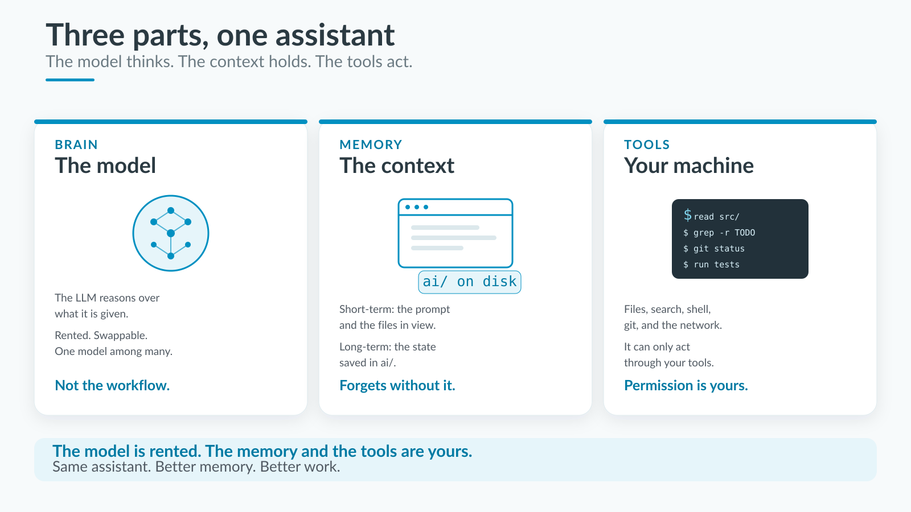

<!-- Speaker notes: The brain is the LLM. It reasons over what it is given, and you can swap it. The memory is the context window plus whatever is saved on disk. The tools are files, search, shell, git, and the network. The model is rented. The memory and the tools are yours. That is why the workflow invests in memory and tools, not in a model. The old deck called this "AI in a nutshell"; it is still the right mental model. -->

---

## The assistant only knows what is in its context

The context window is the assistant's whole world. A web chat knows only what you paste. A local assistant can read the project, the rules, and the saved state.

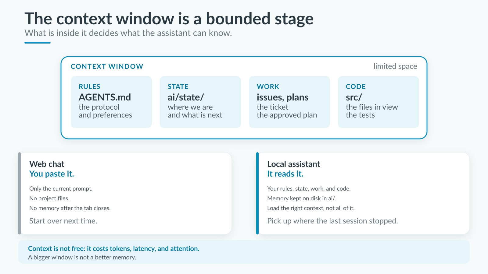

<!-- Speaker notes: The context window is bounded, and everything competes for it: rules, state, the ticket, the plan, the code, and the tests. A web chat knows only what you paste, and it forgets when the tab closes. A local assistant can read the project, but it still has to be told what matters. Context is not free. It costs tokens, latency, and attention. Load the right context, not all of it. Speak to the assistant as a peer, in plain language, not as a command line. -->

---

## A plain chat has no fixed shape

Ad-hoc chat improvises what to load and what to save. The cost is a prompt tax, lost context, and scattered state.

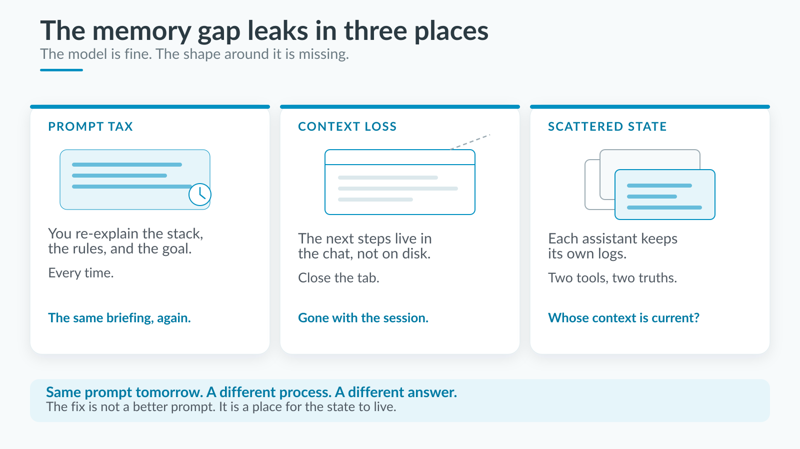

<!-- Speaker notes: The model is fine. The shape around it is missing. The prompt tax is the briefing you repeat every time. Context loss is the next step that lived only in the chat. Scattered state is two assistants with two versions of the truth. The result is that the same prompt tomorrow can produce a different process. This is the problem the workflow solves. -->

---

## The state is not a black box

Without a protocol, each assistant keeps its own state in its own hidden place. The layout, the format, and the mix of decisions change with the assistant.

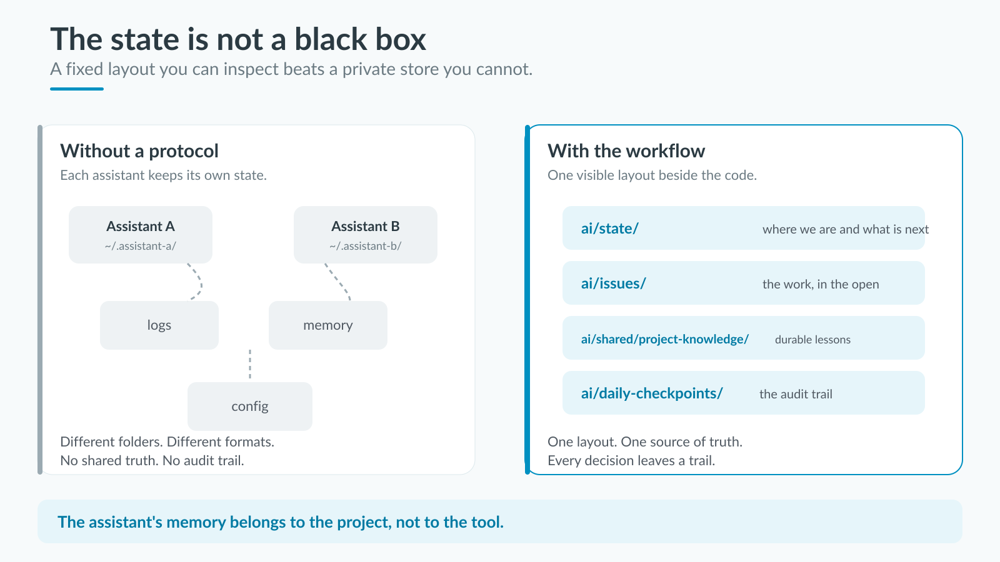

<!-- Speaker notes: This is the state problem behind the memory gap. Each assistant has its own hidden directory and its own format. The user cannot audit the state, and a second assistant starts from scratch. The workflow's answer is the fixed ai/ layout: one visible place beside the code, with the same shape in every project. -->

---

## The ai/ directory is out-of-band memory, outside git

`ai/` is out of band. The project root is not always a Git repository: bootstrap makes `ai/**` git-ignored when the root is a repository, and a solution root keeps its repositories below it. Either way, `ai/` is not application code.

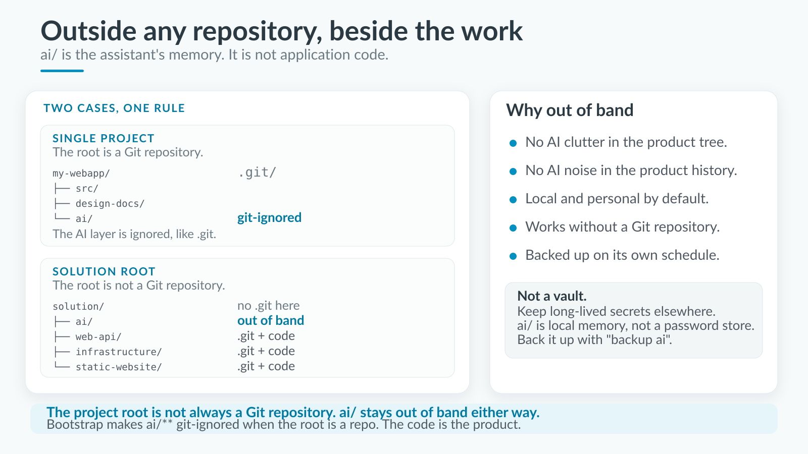

<!-- Speaker notes: Bootstrap adds ai/**, ai-customization.md, and AGENTS.md to .gitignore when the project root is a Git repository. But the root is not always a repository. In the Architect layout, the solution root has no .git; web-api, infrastructure, and static-website each have their own. ai/ sits above them, out of band. It is local and personal, with no AI clutter in the product tree and no AI noise in the product history. It is not a vault. Back it up with "backup ai". This is the old deck's out-of-band management concept, corrected for the Architect case. -->

---

## The ai/ directory is the project's brain

State, diary, knowledge, work, and inbox. All plain text, all local, all inspectable.

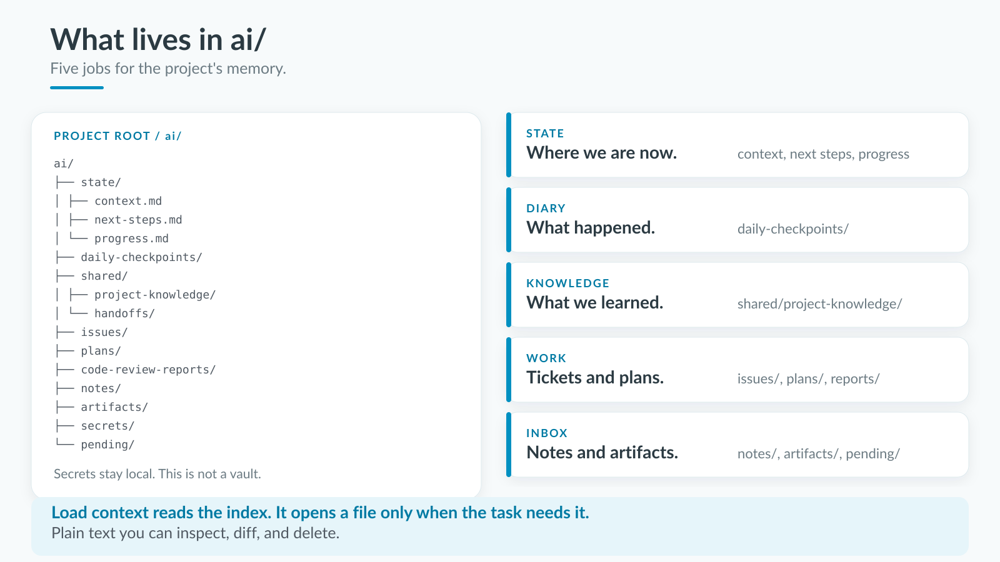

<!-- Speaker notes: State is where we are now: context, next steps, and progress. The diary is the daily checkpoint. Knowledge is the reusable project lesson. Work is the tickets, the plans, and the review reports. The inbox is notes, artifacts, parked work, and local secrets. Load context reads the index; it opens a file only when a task needs it. Every file is plain text you can inspect, diff, and delete. -->

---

## What this is, and what it is not

It is a protocol, not a platform. It is not a model, an agent swarm, or a replacement for your CI and review tools.

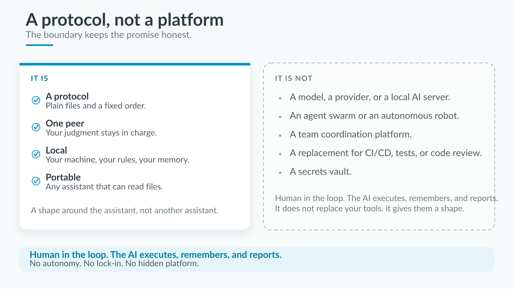

<!-- Speaker notes: Set the expectations before the workflow. It is a protocol of plain files, one peer, local, and portable across assistants. It is not a model, a provider, or a local AI server. It is not an agent swarm or an autonomous robot; the human stays in the loop. It is not a team coordination platform; the optional team store is a small shared layer. It is not a replacement for CI/CD, tests, or code review, and it is not a secrets vault. The old deck's "what it is / what it is not" slide was right; this version matches the current protocol. -->

---

## The AI ladder has seven rungs

Most work stops at copy-paste. The protocol moves the daily work to rung three and makes rung six safe.

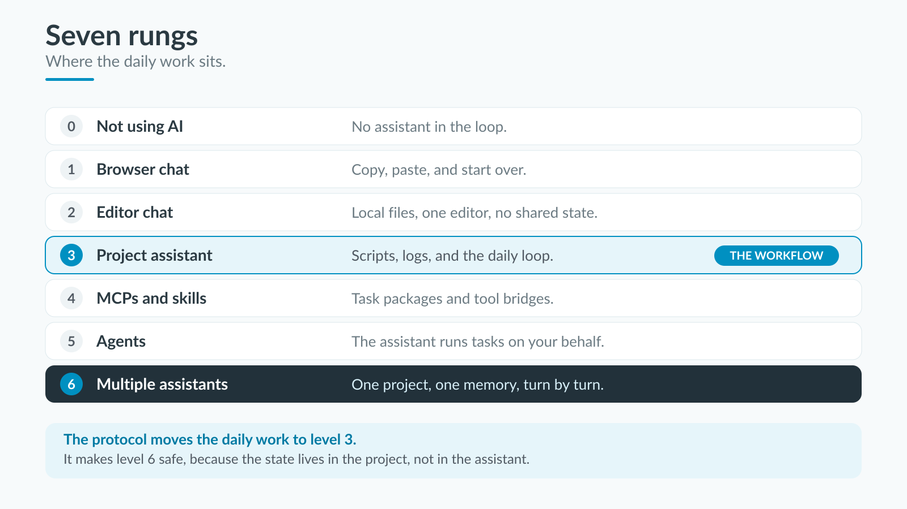

<!-- Speaker notes: The old deck's proficiency model. Level 0 is no AI. Level 1 is browser copy and paste. Level 2 is an editor chat. Level 3 is a CLI assistant in the project. Level 4 adds MCPs and skills. Level 5 is an agent that runs tasks. Level 6 is several assistants on one project. The workflow is not a model upgrade. It is the shape that makes level 3 the daily default and makes level 6 safe. -->

---

## Part 2: The Workflow

The protocol, step by step.

- Load, plan, implement, review, checkpoint.
- One peer, one project, one memory.
- The same trail on every session.

<!-- Speaker notes: Now the protocol itself. The concepts were the why. This act is the how: the fixed shape that turns the pieces into a reliable peer. -->

---

## Two small files start the whole thing

`AGENTS.md` is a pointer. `ai-customization.md` is the project dial. The two keys are `Global AI Workflow Directory` and `Global User AI Directory`. The policy stays in the clone.

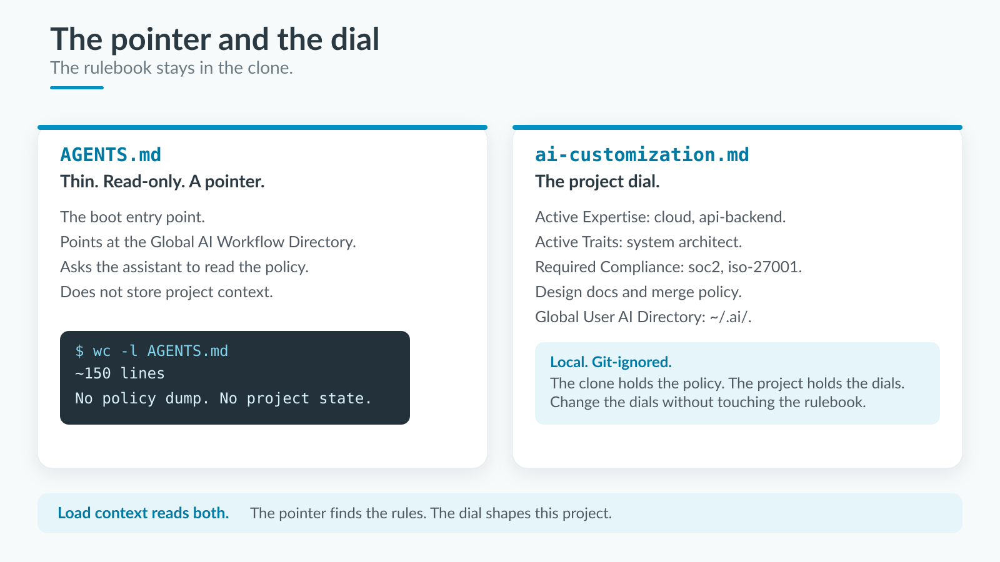

<!-- Speaker notes: This is the old deck's anatomy of AGENTS.md, brought current. The root file is thin, read-only, and points at the global workflow directory. It never stores project context. The customization file is the project dial: expertise, traits, compliance, design docs, merge policy, and optional team keys. Bootstrap keeps both out of Git. The clone holds the rulebook, so syncing a new AGENTS.md is cheap. -->

---

## The workflow is a protocol, not a platform

Plain files give the work an explicit shape.

- **Load** the context and the rules.
- **Plan the issue** as a ticket.
- **Implement the plan** after review.
- **Review** the result.
- **Checkpoint** the state, the diary, and the knowledge.

The result is predictable, reproducible, and auditable.

<!-- Speaker notes: This is the whole promise in one slide. A platform locks you in. A protocol is a set of files and a fixed order that any assistant can follow. -->

---

## One architect, one peer

You set the vision and the definition of done, and you make the decisions. The AI executes, remembers, and reviews.

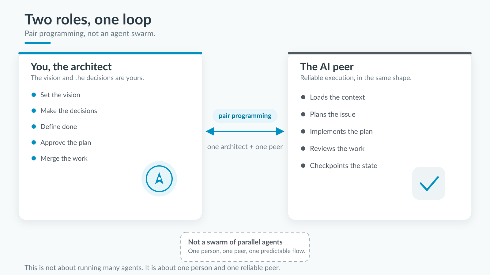

<!-- Speaker notes: You are the architect. The AI is your peer. You: the vision, the definition of done, the design, the trade-offs, the merge. The AI: the context, the plan, the implementation, the review, the checkpoint. The relationship: pair programming, not an agent swarm. The human keeps judgment. The AI keeps the thread. -->

---

## The core case is one person, one project, one peer

A single repository, a single developer, and one AI assistant.

- `AGENTS.md` holds the always-on rules.
- `ai-customization.md` shapes this project.
- `ai/` holds the state, the knowledge, the plans, and the diary.
- Your code stays yours.

No team store is required.

```text
my-webapp/
├── AGENTS.md
├── ai-customization.md
├── ai/
├── design-docs/
└── src/
    ├── api/
    │   ├── routes/
    │   └── services/
    ├── web/
    │   ├── components/
    │   └── pages/
    ├── package.json
    └── tsconfig.json
```

<!-- Speaker notes: This is the case to design for first. The team features are a later, optional layer. The single-repo user must not pay for the team setup. -->

---

## The same protocol scales to a solution root

If the work spans repositories, put `AGENTS.md` and `ai/` at the solution root. The assistant still works from the directory you open.

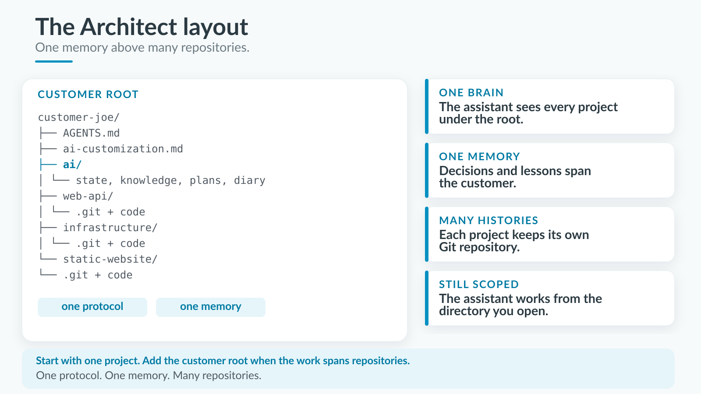

<!-- Speaker notes: This is the old deck's Architect layout, kept as a second case, not the opening. One AGENTS.md and one ai/ sit above web-api, infrastructure, and static-website. The assistant sees every project under the root, the memory spans the solution, and each project keeps its own Git history. It is still scoped: the assistant works from the directory you open. Start with one project. Add the solution root when the work really spans repositories. -->

---

## When you implement an issue, the loop is the same

The loop is a fixed few steps, in the same order.

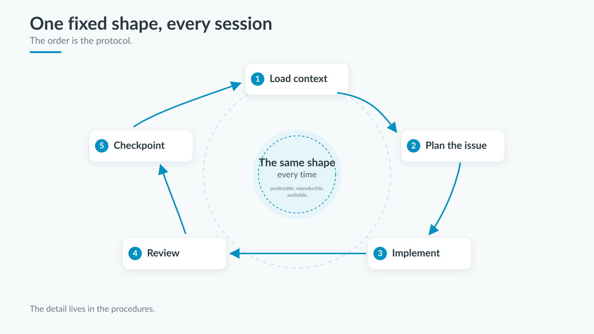

<!-- Speaker notes: Load context: read the rules, the state, and the index. Plan the issue: file the ticket, grill it, write the plan, review it. Implement the plan: branch, test first, build, review. Review: an objective, full-file-set peer review. Checkpoint: the state, the diary, and the knowledge. The loop is the product. Each step has a clear exit. -->

---

## Ticket, issue, or support request

The tracker uses three records, and they are not the same.

- **Ticket**: the container that tracks a task from start to finish. Example: "Ticket #4092: resolve the login outage."
- **Issue**: a code problem, bug, or new feature idea. Example: "The checkout button throws a 500 error on mobile."
- **Support request**: a request for help that rarely needs a code change. Example: "I forgot my password and the reset email is not arriving."

A support request can become an issue when it reveals a bug.

<!-- Speaker notes: The words are not interchangeable. A support request is user-facing help. An issue is engineering work in the codebase. A ticket is the container. A support request often enters as a ticket, and a real bug is linked to or converted into an issue. -->

---

## A session is not one script

The work can start anywhere. The protocol makes the mode explicit.

- **Brainstorm**: widen the options before a design exists.
- **Grill**: challenge the plan before the code.
- **Examine**: read the codebase before the change.
- **Plan**: write the ticket and the plan.
- **Implement**: branch, build, review, checkpoint.
- **Change direction**: stop, record the reason, and re-plan.

The issue loop is the default for implementation. The modes are how a session starts.

<!-- Speaker notes: The fixed few-step loop is not every session. Brainstorming, grilling, examination, and a change of direction are explicit modes. The trail is what stays the same. -->

---

## Three roots: the project's memory, your settings, the rulebook

The project's memory, the personal store, and the central rulebook.

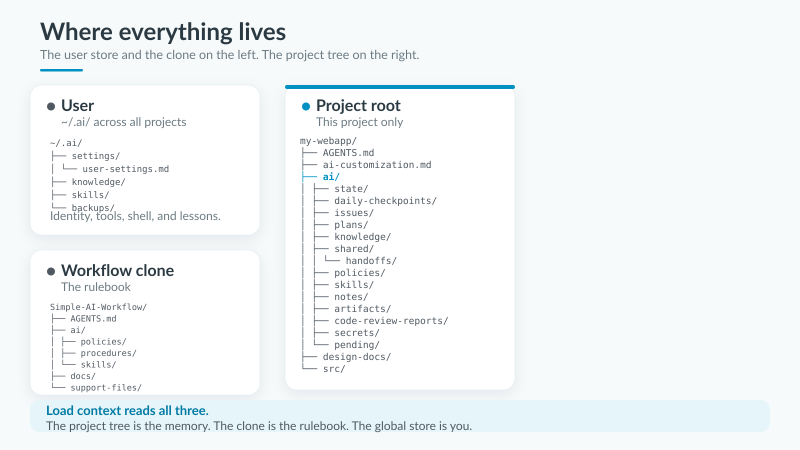

<!-- Speaker notes: Project ai/: state, diary, issues, plans, knowledge, handoffs, policies, skills, notes, artifacts, reviews, secrets, pending. Global ~/.ai/: settings, global knowledge, backups. The clone: policies, procedures, global skills, docs. Load context reads all three. The project tree is the memory; the clone is the rulebook; the global store is you. This clear layout is a core strength. State is visible, portable, and auditable. -->

---

## Two dials: one for you, one for the project

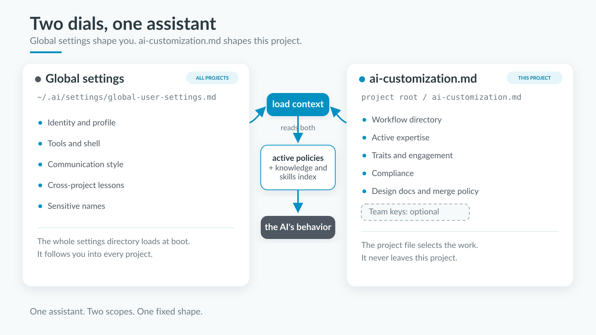

<!-- Speaker notes: Global settings (~/.ai/settings/global-user-settings.md): identity, tools, shell, communication, cross-project lessons. ai-customization.md: the workflow directory, active expertise, traits, compliance, design docs, merge policy, and optional team keys. Load context reads both. The global file shapes the assistant; the project file shapes the work. -->

---

## Compliance is a dial, not a badge

List a standard in `ai-customization.md`. The AI applies the controls from its own knowledge, and the evidence shows up in the work.

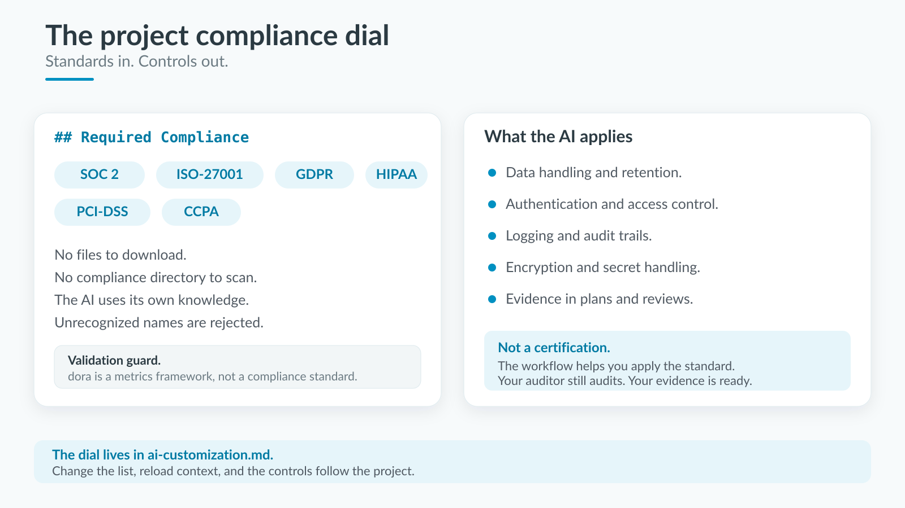

<!-- Speaker notes: This is the old deck's compliance registry, made current. The project lists the standards under Required Compliance. There are no compliance files to download and no compliance directory to scan. The AI applies the controls from its own knowledge: data handling, authentication, logging, encryption, and access control. The evidence shows up in the plans, the reviews, and the design documents. It is not a certification. The auditor still audits; the workflow just leaves the evidence ready. An unrecognized name such as dora is rejected, not treated as a standard. -->

---

## Three scopes, two kinds of memory

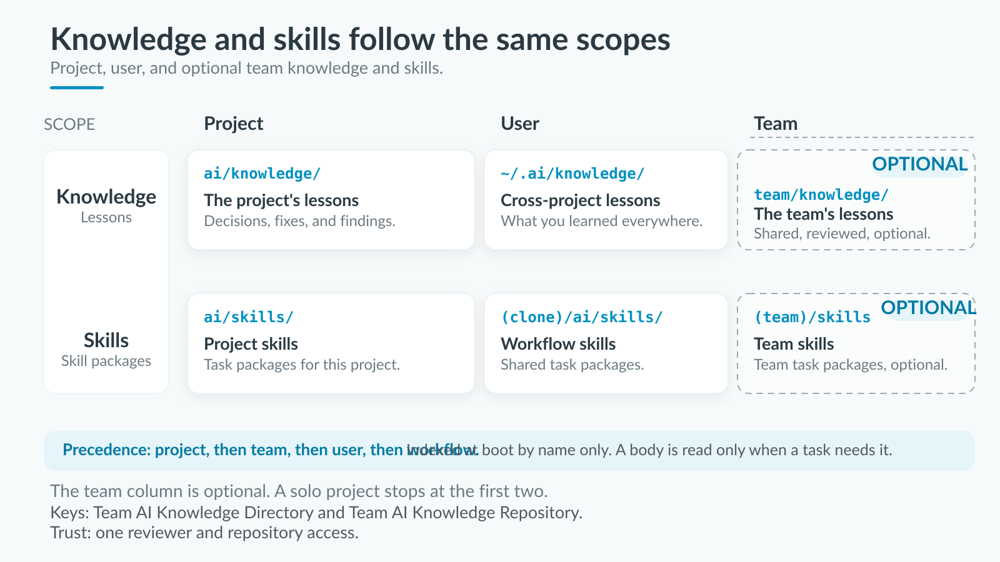

<!-- Speaker notes: Knowledge: project lessons, global lessons, and optional team lessons. Skills: project packages, global packages, and optional team packages. Precedence: project, then team, then global. Indexed at boot and loaded only when a task needs them. The team column is dashed for a reason. A solo project stops at the first two. -->

---

## Skills are a layer, not the workflow

Policies and procedures are the rule layer. Knowledge is the memory. Skills are narrow task packages.

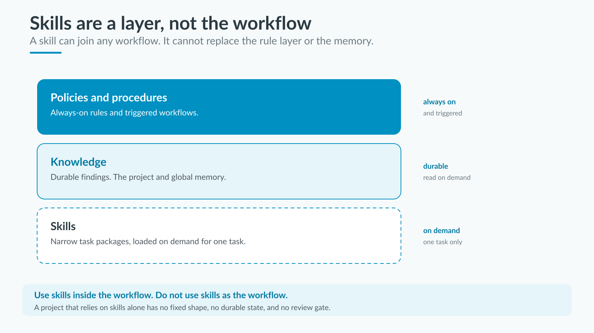

Skills can be part of any workflow. They do not replace policies and procedures.

<!-- Speaker notes: A skill is a task layer. It sits beside the rule layer and the memory, not above them. A project that relies on skills alone has no fixed shape, no durable state, and no review gate. Use skills inside the workflow. -->

---

## Quality is a loop, not a hope

Acceptance criteria, a test written first, a peer review, and a design chain. Every step leaves an artifact.

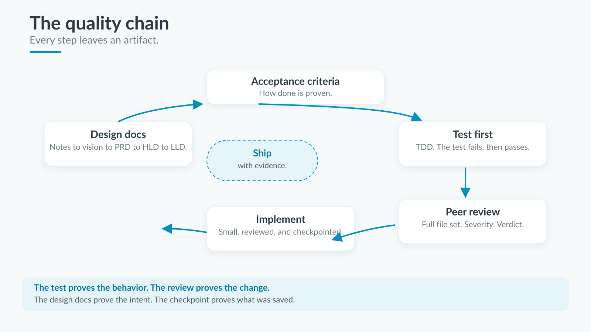

<!-- Speaker notes: This is the old deck's TDD slide, plus the review and design chain. Acceptance criteria say how done is proven. Where the project uses TDD, the test is written first and makes the behavior executable; otherwise the project's own test framework is the standard. Peer review checks the full file set, not just the diff. The design chain records the intent. The test proves the behavior, the review proves the change, and the design docs prove the intent. -->

---

## No vibe coding

Vibe coding accepts code because it looks plausible. The result changes with the mood of the session.

- The quality loop defines the proof.
- Acceptance testing proves it every time.
- The result is repeatable, run after run.

<!-- Speaker notes: The opposite of the loop is vibe coding: accept what looks right, skip the proof, and hope. It is not acceptable because the next run can produce a different answer. Acceptance criteria, a failing test, peer review, and the design chain make the result repeatable. -->

---

## Sharpening the axe is part of the job

Checkpoint, knowledge capture, repair, and backup are not overhead. They are the sharpening.

- A dull axe costs more time than the sharpening.
- The protocol keeps the edge: the state, the knowledge, the review, and the backup.
- The work is not faster. It is straighter.


> We sharpen your axe. We also chop wood, when needed.

<!-- Speaker notes: The wood-cutter's rule. The maintenance work is what makes the next session cheap. The axe photo is from azeemconsulting.com and belongs to the author. -->

---

## Six jobs, one protocol

The lifecycle of a change, in six jobs. The appendix lists every policy and procedure under them.

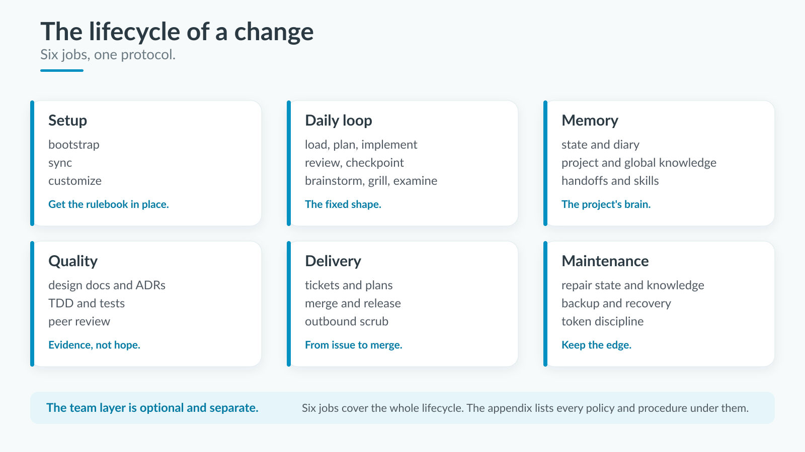

<!-- Speaker notes: Six jobs cover the full lifecycle. The concepts act explained the pieces; these jobs are where the pieces become work. The main deck shows the shape; the appendix names every policy and procedure under each job. Team features are a separate, optional act. -->

---

## This is not about going faster

It is about fewer wrong turns.

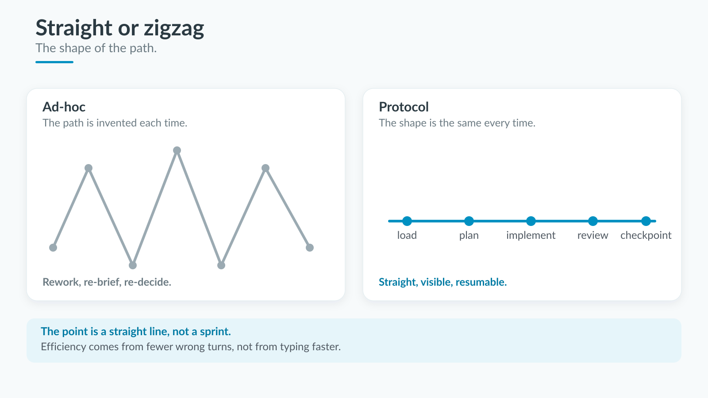

<!-- Speaker notes: The user's own words: efficient, confident, precise, predictable. Not quick, not fast. The protocol removes rework, not thinking. The zigzag is the re-brief, the re-decide, and the rework. The straight line is the same loop every time. -->

---

## A few commands, deliberate friction

- **Load context** at the start of every session.
- **Plan the issue** before the code.
- **Implement the plan**, then review.
- **Checkpoint** after each unit of work.
- **Repair** and **back up** when the workspace needs it.

The friction is the point: you always know what was saved, and why.

<!-- Speaker notes: This is the honest trade-off. A few deliberate commands buy a state you can trust. The protocol is not invisible magic. -->

---

## One-shot prompts are not the goal

A one-shot prompt feels efficient. It skips the review, the checkpoint, and the proof.

- Small steps.
- A visible checkpoint.
- A review before the merge.

Aim for a result you can trust.

<!-- Speaker notes: One-shot pride is the wrong target. The fast answer that skips the loop is hard to trust and hard to repeat. The protocol asks for small steps, a checkpoint, and a review. The friction is the point. -->

---

## Load the index, not the world

The boot reads the rules and the state. Knowledge and skills are indexed by name and opened only when the task needs them.

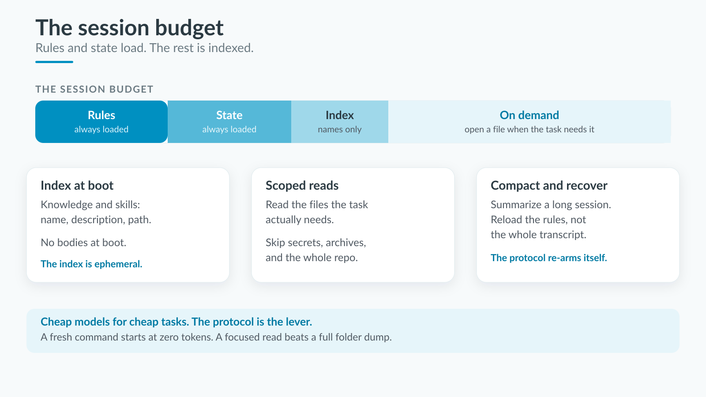

<!-- Speaker notes: This is the old deck's cost slide, made structural. Rules and state load in full. Knowledge and skills are indexed by name, description, and path, and the body is read only when the task needs it. Scoped reads skip secrets, archives, notes, and the whole repository. A long session gets compacted, and you run post-compaction recovery to reload the rules without the transcript. Use a cheap model for a cheap task. The protocol is the lever that keeps the expensive model focused. -->

---

## When the context is compacted, the rules can vanish

A long session fills the window. The harness replaces the history with a summary. The task survives; the standing rules can drop.

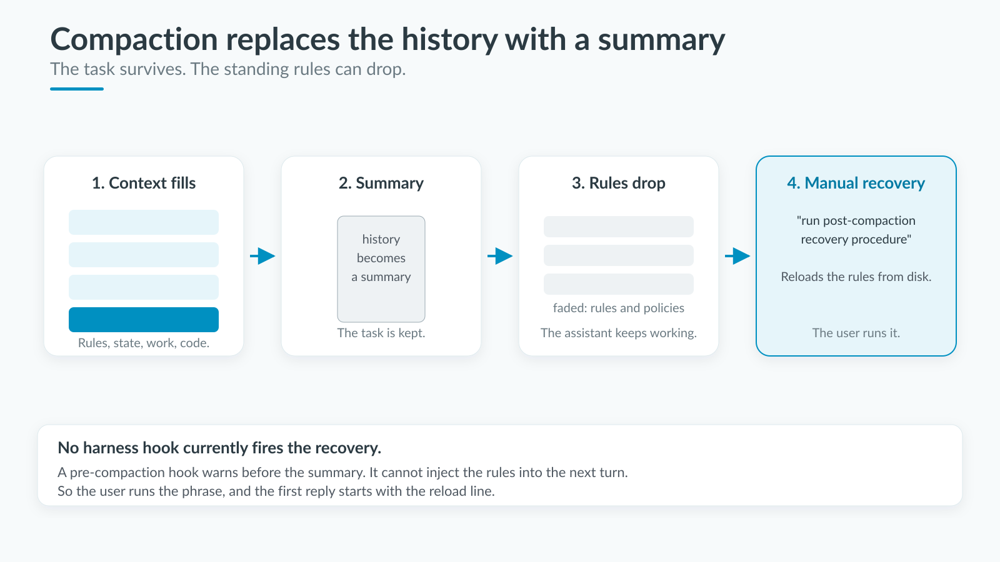

To recover, run `"run post-compaction recovery procedure"`. The first reply starts with the reload line.

<!-- Speaker notes: Compaction is normal in a long session. The summary keeps the task, but the rules, policies, and loaded knowledge can drop. The recovery is manual: no harness hook currently fires it. The user runs the phrase, and the procedure reloads the rules from disk. -->

---

## Git is your safety net

Branch before the work. Commit often. Review, squash-merge, and push when the checks pass. The AI drives; you approve.

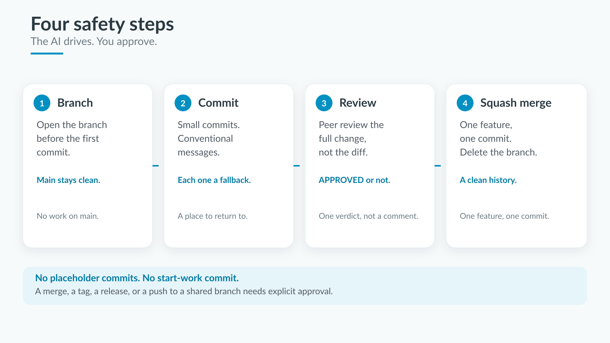

<!-- Speaker notes: The old deck's Git slides, condensed. Open the branch before the first commit. Use conventional commits and no placeholder commit. Review the full change. Squash-merge to keep one feature as one commit, delete the branch, and push. The implementation request approves the branch, the commits, and the push. The merge, the tag, the release, and every external write need their own approval. In a team repository, the merge mode is pr and one reviewer merges. -->

---

## Part 3: Proof

The claims are inspectable.

- The same task in two shapes.
- The repository as the case study.

<!-- Speaker notes: We have explained the pieces and the shape. Now show that the shape leaves evidence you can check. -->

---

## Same task, two shapes

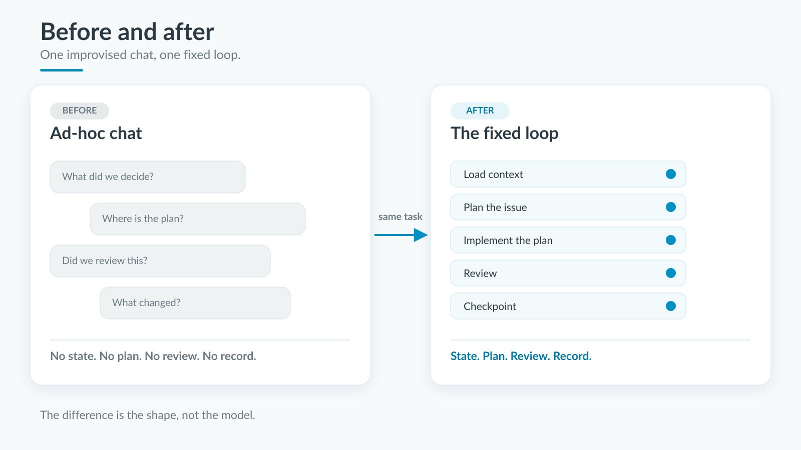

<!-- Speaker notes: Before: a chat with no state, no plan, no review, and no record. After: a ticket, a plan, a review, a checkpoint, and a project that remembers. Both can produce code. Only one can show you how it got there. The difference is the shape around the work. One leaves a trail; the other leaves a transcript. -->

---

## The repository is the proof

- It has 25 policies, 16 procedures, and 53 triggers.
- It has 31 tests, 18 user-facing docs, and hundreds of review reports.
- It has a public issue tracker, daily checkpoints, and release notes.
- Every change went through the same plan, review, and checkpoint shape.

The proof is not a benchmark. It is the repository.

<!-- Speaker notes: The counts are current at the time of the deck. The test suite pins them. The repository itself is the case study. -->

---

## Team features are not for everyone

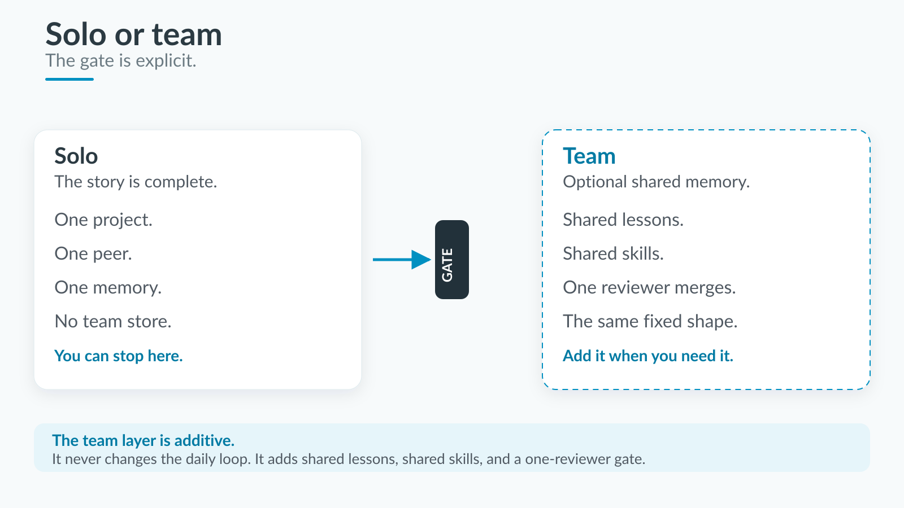

<!-- Speaker notes: This is a hard gate, not a soft suggestion. The solo story is complete; you can stop here. The next two slides are optional; they cover the team knowledge store and the team skills root. The team layer is additive. It adds shared lessons, shared skills, and a one-reviewer gate. It never changes the daily loop. -->

---

## Team knowledge and team skills are optional roots


<!-- Speaker notes: The team column of the map. Team knowledge lives in lessons/ and is indexed by filename. Team skills live in skills/ and are indexed by name and description. The two keys are Team AI Knowledge Directory and Team AI Knowledge Repository. Precedence is project, then team, then global. The team repository's one-reviewer PR gate and access control are the trust boundary. The protocol does not verify the review at boot. Repository access is the privacy control. -->

---

## Publish a lesson, copy a skill, one reviewer merges

The team store is a Git repository, not a service.

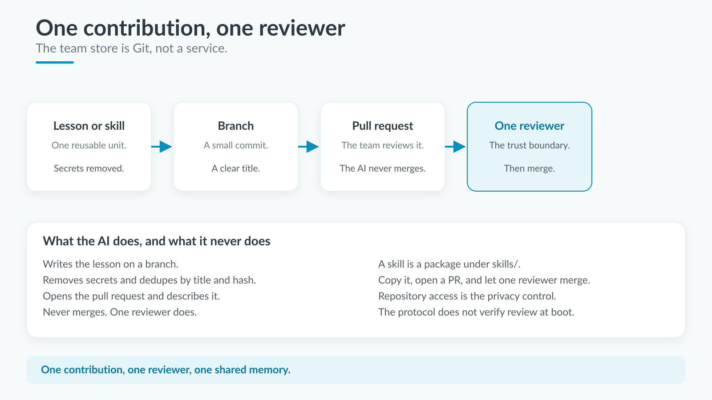

<!-- Speaker notes: Contribution is deliberately manual at the gate. Say "update team knowledge" and the AI writes the lesson on a branch and opens a PR. A skill is a package under skills/; copy it and open a PR. The AI never merges. One reviewer keeps the trust boundary. -->

---

## Multiple assistants, turn by turn

The protocol supports multiple assistants, turn by turn.

- **Turn by turn**: one assistant drives, checkpoints, and the next continues from the same state.
- **Handoffs**: run an assistant on a handoff independently while you work on the main task.
  - **Some parallelism**: two tracks can move at once.
  - **The condition**: the handoff must be solid and completely independent. The handoff policy already ensures that.

Think of a road trip with several drivers.

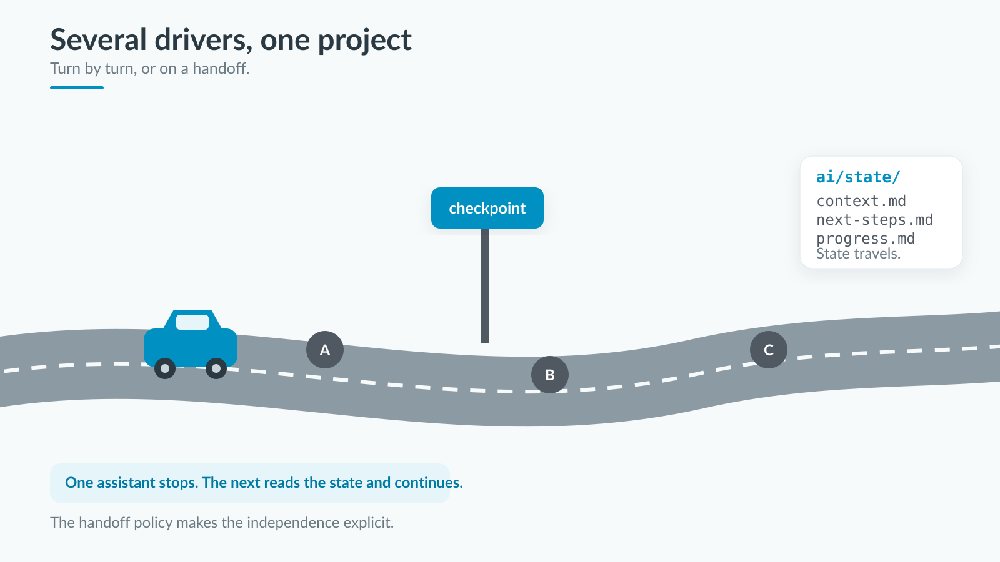

<!-- Speaker notes: The handoff policy makes the independence explicit. The state is the handoff. -->

---

## Five minutes to the first loop

Clone, create, copy, set, bootstrap, load. No install scripts.

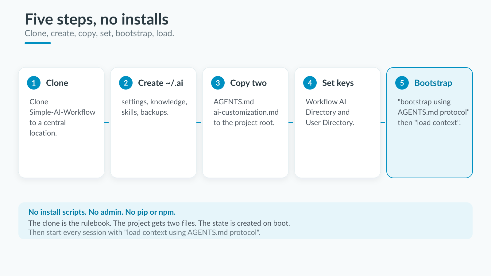

<!-- Speaker notes: The quick start is deliberately small. The clone is the rulebook; the project gets two files; the state is created on boot. Set the two directory keys in ai-customization.md, bootstrap, then load context. Bootstrap also adds ai/**, ai-customization.md, and AGENTS.md to .gitignore. -->

---

## The trail is the same, even when the session is not

You are the architect. The AI is your peer.

- **Issue work** follows the loop: load, plan, implement, review, checkpoint.
- **Brainstorm, grill, examine, or change direction** are explicit modes.
- **A checkpoint** leaves the state, the diary, and the knowledge.
- **The trail** is what makes the next session cheap.

Stop improvising. Start leaving a trail you can inspect.


[GitHub: KamranAzeem/Simple-AI-Workflow](https://github.com/KamranAzeem/Simple-AI-Workflow) | [azeemconsulting.com](https://azeemconsulting.com) | CC BY 4.0

<!-- Speaker notes: Close with the axe and the promise. The fixed shape is the product. The user is the architect; the AI is the reliable peer. The concepts were the pieces. The workflow is how the pieces stay in place. -->

---

## Appendix: Setup

Bootstrap once, then keep every project on the same rulebook.

- **`AGENTS.md`** — the thin, read-only pointer to the workflow clone; no project context.
- **`ai-customization.md`** — the project dial: expertise, traits, compliance, design docs, merge policy, and team keys.
- **bootstrap-project** — creates the project layer, the `.gitignore` entries, the state skeleton, and the first load.
- **sync script** — propagates the clone's `AGENTS.md` update to every project.
- **common policy** — the always-on guardrails: precedence, investigation, communication, git, compliance, and state.
- **global-settings policy** — identity, tools, shell, and cross-project preferences.
- **repair-global-settings** — heals the global settings files when they drift.
- **Custom policy** — clone a domain policy, tailor it, and keep it in the central policy directory.
- **Active expertise** — load a domain policy: cloud, API, web, data, DBA, observability, Linux, Windows, or mobile.

<!-- Speaker notes: Every item in this appendix is a real policy, procedure, or root file. The setup layer is small: two root files, a bootstrap, a sync script, the common guardrails, and the global settings. The domain policies are the shelf behind Active Expertise. -->

---

## Appendix: Daily loop

The fixed shape, one step at a time.

- **load-context** — reads the protocol, settings, policies, state, and indexes knowledge and skills.
- **manage-issues** — files, lists, closes, reopens tickets, and writes and reviews plans.
- **implement-plan** — branch, test-first, build, peer review, and checkpoint.
- **write-checkpoint** — writes the state, the diary, and the knowledge pass in one atomic transaction.
- **Thinking-modes policy** — grill, brainstorm, examine, plan, and change direction as explicit modes.
- **issue-management policy** — the ticket shape, status folders, external trackers, and the plan gate.
- **The full load phrase** — `"load context using AGENTS.md protocol"`, not a bare `"load context"`.

<!-- Speaker notes: This is the daily loop. Each procedure ends at its own step: a ticket request does not cascade into a plan, and a plan request does not open a branch. The full load phrase matters because a bare load context reads the assistant's own memory, not the protocol. -->

---

## Appendix: Memory, 1 of 2

The project brain, written in plain text.

- **State files** — `context.md`, `next-steps.md`, `progress.md`; a 30 KB budget and a 300-character line cap.
- **Atomic writes** — the three files are written together at checkpoint, or not at all.
- **Daily checkpoints** — the diary and the only archive; one file per day, one section per checkpoint.
- **Knowledge policy** — the header, the Context/Rule/Why/Verify shape, 10/15 KB targets, and the 50-file threshold.
- **Project knowledge** — durable lessons, indexed at boot and read only when a task needs them.
- **Global knowledge** — cross-project lessons with identifying names removed.
- **Knowledge-publish** — writes one lesson to the team store on a branch and opens a PR.

<!-- Speaker notes: The memory layer is plain text. The state files are summaries, not runbooks. The diary is the only archive. Knowledge is indexed at boot and read on demand. The knowledge policy owns the header, the shape, the size targets, and the 50-file threshold. -->

---

## Appendix: Memory, 2 of 2

Design, recovery, and repair.

- **Design-docs policy** — notes → vision → PRD → HLD → LLD → ADRs → delivery ledger.
- **update-design-docs** — writes or updates a document, shows a diff, challenges the design, and updates the ledger.
- **migrate-design-docs** — moves old design docs from knowledge into `design-docs/`.
- **post-compaction-recovery**: reloads the rules when you run it after a summary; no harness hook currently fires it.
- **repair-knowledge-files** — audits and repairs the stores with a conservation manifest.
- **repair-state-files** — reorders, trims, restores headers, and never drops an unfinished next step.
- **Knowledge standards** — one lesson in one place; a project or global store; no pointers.

<!-- Speaker notes: The design chain is the intent layer. The repair procedures are the maintenance layer. Run post-compaction recovery after a summary; it reloads the rules without the stale state. Knowledge standards keep one lesson in one place. -->

---

## Appendix: Quality, 1 of 2

Design, tests, and review.

- **Design-docs policy** — forces the design chain before code; small work gets context and acceptance criteria.
- **Acceptance criteria** — every plan says how done is proven, before the code is written.
- **TDD and testing standards** — test first, deterministic tests, failure modes, and the project's framework.
- **Code-review policy** — strict reviewer, full file set, severity, "Not Checked", and a verdict.
- **run-peer-review** — scans the diff and the full files, checks live state when possible, and writes a numbered report.
- **Coding-baseline policy** — the base layer for safe, consistent code; domain policies add the specifics.
- **Review rounds** — 2 to 4 passes are normal because every pass sees the full file set.

<!-- Speaker notes: The design chain and the acceptance criteria come before the code. TDD makes the behavior executable. Peer review is a role, not a comment. The coding baseline is the base layer. Multiple rounds are normal because each pass sees the full file set. -->

---

## Appendix: Quality, 2 of 2

Examination, investigation, and compliance.

- **Codebase-examination policy** — disk-backed repo maps and JIT loading for large codebases.
- **examine-codebase** — builds the map, tiers the reads, and answers from evidence, not guesses.
- **Investigation contract** — investigate, verify, then assert; local-first; "not verified" when you cannot.
- **Compliance intelligence** — the standards in `ai-customization.md` applied from AI knowledge, not files.
- **Validation guard** — reject an unrecognized name such as `dora` and offer an annotation.
- **Evidence** — plans, reviews, and design docs show the controls.
- **Not a certification** — the workflow helps you apply the standard; your auditor still audits.

<!-- Speaker notes: The codebase examiner never assumes the whole repo fits in context. The investigation contract is the evidence rule. Compliance is applied from AI knowledge; the evidence lives in the work. -->

---

## Appendix: Delivery, 1 of 2

Tickets, plans, and merge.

- **Issue-management policy** — local and external tickets, plan review, and close semantics.
- **manage-issues** — file, list, close, reopen, and plan.
- **implement-plan** — branch, commits, push, and the merge mode.
- **Merge policy** — direct, PR, or auto; the merge, tag, and release still need approval.
- **Branch gating** — explicit approval before state-changing Git operations on main.
- **Git safety** — conventional commits, no placeholder commits, squash merge, and the PR path.
- **Author identity** — your Git identity; never an AI signature or a generated email.
- **Release notes** — the changelog and tag follow the merge.

<!-- Speaker notes: A ticket request ends at the ticket. A plan request ends at the plan. The implementation request is the approval for the branch, the commits, and the push. The merge, the tag, the release, and every external write need their own approval. -->

---

## Appendix: Delivery, 2 of 2

Scrub, handoffs, and multiple assistants.

- **`outbound-content-scrub` policy** — Class A/B, secrets always removed, approval and category report.
- **Handoff policy** — objective, authorization, scope, starting facts, steps, binding rules, report back, review, verification.
- **create-handoff** — drafts and reviews a handoff, then writes the final file.
- **Coordination board** — announce, claim, complete, and clear.
- **Multiple assistants** — turn by turn, with the state as the handoff.
- **Parallel handoffs** — only when the handoff is solid and completely independent.
- **Team merge mode** — a pull request and one reviewer; the AI never merges.

<!-- Speaker notes: The outbound scrub is the privacy gate for anything that leaves the project. The handoff policy is the authorization and verification contract. Multiple assistants work turn by turn; parallel handoffs need real independence. -->

---

## Appendix: Maintenance, 1 of 2

State, knowledge, and settings.

- **repair-state-files** — reorders, trims, restores headers, and never drops an unfinished next step.
- **repair-knowledge-files** — audits, backs up, writes a candidate, reviews, and restores on failure.
- **repair-global-settings** — heals the global settings files.
- **State-file health** — the shared budget, the line cap, and the daily archive.
- **Knowledge standards** — 10 KB soft target, 15 KB cleanup, and the 50-file review threshold.
- **Atomic writes** — progress, next steps, and context, in that order.
- **Checkpoint report** — one line per upkeep step, plus the stale-item flags.

<!-- Speaker notes: The maintenance layer is the sharpening. The repairs are safe and conservative. The checkpoint reports; the repair deletes only after the archive has the detail. -->

---

## Appendix: Maintenance, 2 of 2

Backup, recovery, token, and meta.

- **create-backup** — `"backup ai"` writes a timestamped archive to `~/.ai/backups/`.
- **post-compaction-recovery**: the manual reload you run after a summary; no harness hook currently fires it.
- **validate-protocol** — the 8-step validator for the protocol tree.
- **Lint** — markdownlint and shellcheck on the changed files.
- **Token discipline** — index at boot, load on demand, compact, and use scoped reads.
- **Meta policy** — protocol developer mode, validation, and release discipline.
- **Sync** — the clone is the rulebook; the project is the copy.

<!-- Speaker notes: Backup is on demand, not part of checkpoint. Recovery is manual: you run the phrase after a summary, because no harness provides a working post-compaction hook. The validator and lint are the release checks. Token discipline is the budget. The meta policy is the maintainer mode. -->

---

## Appendix: Team

Optional shared memory.

- **`team-knowledge` policy** — the team store, team lessons, precedence, and the trust boundary.
- **knowledge-publish** — writes a lesson on a branch and opens a PR; the AI never merges.
- **Team skills** — a shared `skills/` root with the same package shape and one-reviewer merge.
- **Handoff policy** — parallel work with a solid, independent handoff.
- **Coordination board** — announce, claim, complete, and clear.
- **Trust boundary** — repository access and one reviewer; the protocol does not verify review at boot.
- **Precedence** — project, then team, then global.

<!-- Speaker notes: The team layer is optional. The team store is a Git repository. One reviewer is the trust boundary. The protocol does not verify the review at boot; repository access is the privacy control. -->

---

## Appendix: Compliance

Standards without files.

- **Required Compliance** — list the standards in `ai-customization.md`.
- **No on-disk files** — apply them from AI knowledge; never scan for compliance files.
- **Recognized standards** — GDPR, CCPA, ISO-27001, SOC2, PCI-DSS, HIPAA.
- **Validation guard** — reject an unrecognized name such as `dora` and offer an annotation.
- **Contextual controls** — data handling, authentication, logging, encryption, and access control.
- **Evidence** — the controls show up in plans, reviews, and design documents.
- **Not a certification** — the workflow helps you apply a standard; it does not certify you.
- **Compliance guide** — `docs/compliance-guide.md`.

<!-- Speaker notes: This is the full compliance contract. The standards are listed in the project dial. The AI applies the controls from its own knowledge. The evidence is in the work. The workflow is not a certification body. -->

---

## Appendix: Domain expertise

The full policy shelf.

- **Academic research** — literature, experiments, statistics, and manuscripts.
- **Accounting** — ledgers, GAAP/IFRS, tax, and audit.
- **API backend** — contracts, persistence, jobs, and integration.
- **Career coaching** — CV, interviews, and negotiation.
- **Cloud** — IaC, pipelines, Kubernetes, and cloud security.
- **Data** — schemas, contracts, quality, access, and pipelines.
- **DBA** — schema changes, tuning, backup, and recovery.
- **Linux admin** — servers, services, security, and reliability.
- **Mobile apps** — iOS, Android, cross-platform, and app stores.
- **Observability** — logs, metrics, traces, SLOs, and alerts.
- **Web frontend** — components, state, accessibility, and performance.
- **Windows admin** — Windows Server, AD, M365, and Azure hybrid.

<!-- Speaker notes: Each domain policy has its own role, scope, standards, and triggers. Active Expertise loads the ones this project needs. The trigger phrases load one for a session. The common policy stays the baseline; the domain policy adds the specifics. -->

---

## Appendix: Traits and skills

The behavioral layer and the task layer.

- **Traits** — system architect, system integrator, senior DBA, observability architect, code reviewer, security specialist, teacher.
- **Skills** — narrow, on-demand task packages; project, global, and team roots.
- **Precedence** — project, then team, then global.
- **Activation** — `"use skill <name>"` or a single best description match.
- **Trigger index** — rebuilt at boot; a triggered policy does not survive compaction.
- **Custom policy** — clone and tailor; keep it in the central policy directory.
- **Policy anatomy** — a role, a scope, the standards, and a loading path.

<!-- Speaker notes: Traits shape how the assistant behaves. Skills give it a narrow task package. Policies are always-on or domain rules. Knowledge is durable findings. The trigger index is ephemeral. -->

---

## Appendix: Commands

The commands you type.

- `"bootstrap using AGENTS.md protocol"`
- `"load context using AGENTS.md protocol"`
- `"plan the issue <file or #N>"`
- `"implement the plan"`
- `"peer review"`, `"code review"`, `"PR review"`
- `"checkpoint"`
- `"update project knowledge"`, `"update global knowledge"`
- `"repair state files"`, `"repair knowledge files"`
- `"backup ai"`
- `"run post-compaction recovery procedure"`
- `"update team knowledge"`, `"publish to team knowledge"`
- `"use policy <name>"`, `"use skill <name>"`
- `"update design documents"`, `"migrate design docs"`
- `"grill me"`, `"brainstorm"`

<!-- Speaker notes: The full command sheet. The workflow guide is the reference. The commands are the interface; the policies and procedures are the engine. -->
