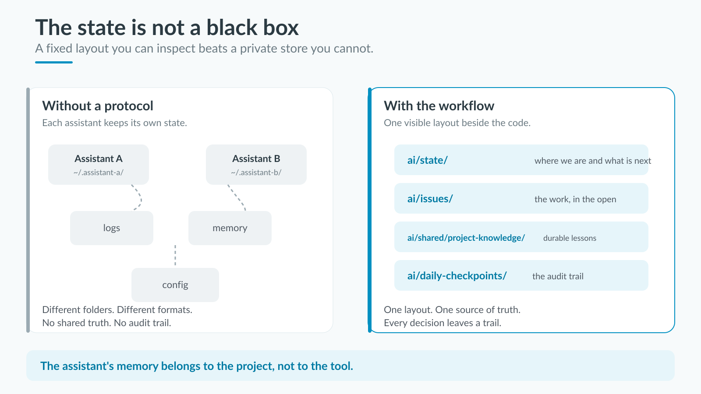
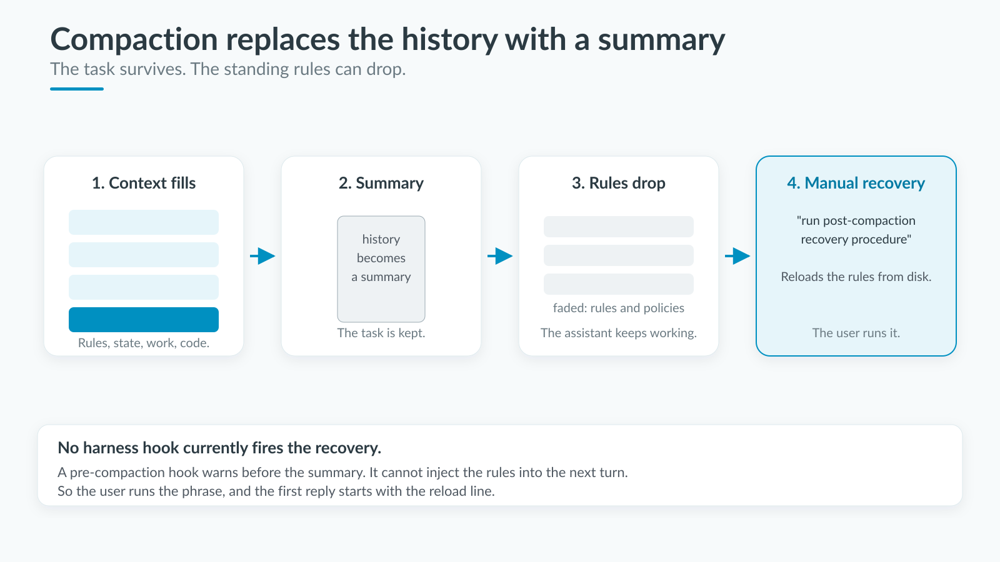
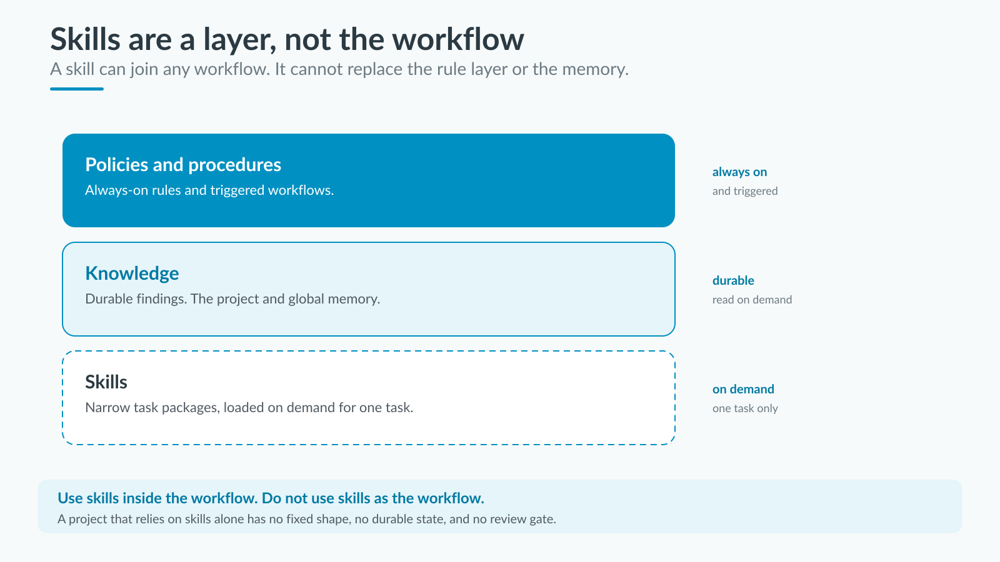

# AI Usage Guide

This guide explains how to interact with AI assistants in this repository and how to manage the AI state tracking files.

## 1. Project Knowledge (`ai/knowledge/`)

All persistent AI reasoning, style guides, and project-specific patterns are stored here.

- **Location**: `/ai/knowledge/` (Git-ignored)
- **Status**: Non-version-controlled. Each contributor builds their own project knowledge base.
- **Usage**: Add Markdown files for permanent guidance (e.g., `css-architecture.md`, `style-guide.md`).
- **Policy**: AI assistants treat this directory as the source of truth for repository standards.
- **Checkpoint Sync**: The AI is required to review and update this directory at every checkpoint, capturing any new findings, decisions, or discoveries from the session: even if nothing changed (confirmation is mandatory).
- **Format**: Each file starts with the self-contained header and follows one shape: Context, Rule or Fix, Why, Verify, and Caveats if needed. Name it for the task it answers, with six or fewer hyphenated segments. Use 10 KB as a soft target; a file over 15 KB gets an automatic cleanup during repair. Split only by task topic, merge a file under 3 KB into its topic, and treat 50 files per store as a review threshold. Keep each file self-standing, with no pointers to other files. Project knowledge may keep identifying names; raw secrets are banned. See Section 23.

### Why the state lives with the project

Without a protocol, each assistant keeps its own state in its own hidden directory. The layout, the format, and the mix of decisions, configuration, and knowledge change with the assistant. The three problems are a mixed state, per-agent layouts, and no audit trail. Switching assistants starts from scratch. The fixed `ai/` layout puts the state in one visible, portable place beside the code, so you can inspect it and take it with you. The long-form comparison is in [how the assistants store context and how this workflow fits](simple-ai-workflow-compared-to-all-ai-assistants-out-there.md).



## 2. User Knowledge (Cross-Project)

Lessons learned, architectural patterns, and reusable snippets that apply across all your repositories.

- **Location**: `<User AI Directory>/knowledge/` (default `~/.ai/knowledge/`; the user directory is configurable in `ai-customization.md`)
- **Status**: Personal persistent memory that follows you into every project.
- **Usage**: Indexed at initialization (index-at-boot, load-on-demand) under the same Token Rationing model as **Project Knowledge**; see **[Section 13: Token Rationing & JIT Context Loading](#13-token-rationing--jit-context-loading)**.
- **Policy**: AI assistants use this to ensure consistency and reuse best practices from your previous work. Use descriptive filenames so each file is easy to identify; the filename is also the lookup key for index-only Global and Project Knowledge. See **[Use Verbose File Names for Knowledge and Notes](../README.md)**.
- **Format**: Same standard as project knowledge; see Section 23. Global knowledge removes identifying names, and raw secrets are banned.

## 3. Task Handoffs (`ai/shared/handoffs/`)

Used for transferring specific tasks and context between AI assistants or sessions.

### How to Create a Handoff Task

Say `create handoff` and give the task, the receiver, the parallel work, the destination, and the authorization. The `CREATE-HANDOFF` procedure loads `ai-policy-handoff.md`, drafts the handoff under `ai/artifacts/handoffs/<handoff-slug>/`, runs a peer review, and writes the final handoff only after APPROVED.

The handoff policy owns the template: Objective, Authorization, Read first, Scope, Starting facts, Steps, Binding rules, Shared output paths, Report back, Review, and Verification. The final file is `ai/shared/handoffs/<handoff-slug>.md`.

**Instruction to AI**:
To have the AI generate and save a handoff for you:
> *"Create a handoff task for [task name] with [details] and save it to the handoffs directory."*

### How to Execute a Handoff Task

To tell the AI to start working on a handoff:
> *"Claim and execute [filename] from the handoffs directory."*

The AI will:

1. Load `ai-policy-handoff.md` and verify the handoff is valid.
2. Record ownership in `ai/shared/coordination.md`.
3. Work on a feature branch and run every verification step.
4. Merge the branch when the conditional autonomy conditions pass; the receiver does not write the three state files.
5. Append a `## Completion` note to the handoff and clear the claim.
6. Leave the handoff for the original orchestrator, which records it at the next checkpoint and then deletes it.

## 4. Working with Git

The workflow does not inject Git history into the state files. Git is the source of truth for version control, and the state files never record a branch, commit hash, or push status (see [Section 14](#14-atomic-write-protocol--state-file-trimming)).

What the protocol does enforce around Git:

- **Branch gating**: obtain explicit approval before state-changing Git operations on `master` or `main`.
- **No pre-work commits**: never commit a start-work or placeholder commit; when a work item goes on a branch, open the branch before the first commit.
- **Conventional commits**: follow the project's commit conventions (for example `feature:`, `fix:`, `chore:`, `docs:`).
- **PR review**: peer review can target a named pull request; the AI fetches the latest refs and diffs the PR's source against its target, not the local working tree (see [Section 12](#12-peer-review-mode)).

The AI does not rely on commit history to rebuild project context. If you want a decision or design recorded, it belongs in `ai/knowledge/` or the daily checkpoints, not in the state files.

For a recommended Git setup (identity, CRLF handling, and a readable `git lg` alias), see the Git Configuration section in the [user settings template](user-settings.md).

### Agent Collaboration

Multiple assistants can work on one project through the shared `ai/` directory.

- Announce the task on the coordination board (`ai/shared/coordination.md`) before starting it.
- Claim a handoff, validate it against the handoff policy, execute it on a feature branch, verify it, then append a `## Completion` note and clear the claim.
- Treat every tracking-file update as a fresh read followed by an immediate write.
- If an agent detects an unauthorized change, pause and ask the human.
- A receiver merges only when the handoff is valid, the creation review is APPROVED, every verification step passes, and the board is updated. The receiver does not write the three state files; the original orchestrator records the state at the next checkpoint and deletes the handoff.
- The human can check `ai/state/progress.md`, `ai/state/next-steps.md`, and `ai/shared/coordination.md`.
- See the [multi-agent runbook](multi-agent-runbook.md) for a three-assistant walkthrough.

## 5. Expertise & Intent Alignment (Review-First)

To prevent AI assistants from prematurely implementing code changes when you only wanted to ask a question, the workflow enforces a strict intent alignment protocol.

### Directive vs. Inquiry

The system distinguishes between two types of requests:

- **Inquiry**: Requests for analysis, advice, observations, or "how-to" explanations.
- **Directive**: Explicit instructions to perform a task, fix a bug, or implement a feature.

### The "Analyze-Plan-Stop" Rule

For all **Inquiries**, the AI is mandated to:

1. **Analyze**: Share technical thoughts, opinions, and analysis of the problem.
2. **Plan**: Propose a specific implementation strategy, including which files will be changed or created.
3. **Pause and wait**: The AI MUST NOT proceed with code modifications until it receives an explicit **Directive** from you.

### Benefits

- **Full Control**: You review the plan before a single line of code is changed.
- **Token Efficiency**: Prevents wasted tokens on incorrect or unwanted implementations.
- **Higher Quality**: Forces the AI to "think" (plan) before it "acts," leading to more robust solutions.

### Shared understanding before building

For feature and architectural work, the AI reaches a shared design concept with you before it creates files or writes code. It walks the design tree branch by branch and asks questions until you agree on what is being built. Small, low-risk changes skip this and keep a light pass.

## 6. Idiot-Proof Protocol (Low-IQ Compatibility)

### Structural Guardrails

Models with lower instruction-following capability (e.g., smaller or "lite" models) sometimes treat protocols as suggestions, leading to accidental re-initialization or overwriting of context files. This workflow implements high-visibility structural cues to prevent this:

- **Immortality Headers**: A high-visibility `⚠️ STOP` header at the top of `AGENTS.md` prevents AI from modifying the protocol.
- **Immutable Loading**: The context-loading sequence is explicitly flagged as **READ-ONLY**, preventing "instruction drift" during bootstrap.
- **No-Overwrite Mandates**: The context-loading sequence forbids overwriting existing files, ensuring project history is never accidentally wiped.
- **PWD-Only Scope**: The AI is restricted to loading `AGENTS.md` and scanning the `ai/` directory from the current working directory only: prevents cross-project context leakage and ensures each project maintains its own isolated AI state.
- **Recursive Discovery**: AI uses the built-in glob and listing on the **User AI Directory** to find the settings, knowledge, skills, and backups subdirectories.
- **Proof-of-Load Summary**: The AI must explicitly list all Settings files fully loaded and Knowledge files indexed, providing empirical evidence of a successful bootstrap.
- **Update Check**: The AI compares your workflow clone with its remote at load time and tells you when a pull is available. It never pulls for you.

### Benefits

- **Reliability**: Use lower-cost models without risking project state.
- **Consistency**: The same protocol works safely across any IQ tier.
- **Visibility**: You know exactly what intelligence the AI has loaded before you start work.

## 7. Session Resume (Compacted Context)

When the conversation is compacted, the harness replaces the live history with a summary. You see the "Compacted conversation" label. The standing rules can drop out of context. The **Post-Compaction Recovery** procedure reloads them.

### The compaction phenomenon

The summary keeps the task. The standing rules, policies, and loaded knowledge can drop out. The assistant keeps working with a thinner context. It can quietly break your conventions.



**It is not automatic.** No harness currently provides a reliable hook that fires after compaction and re-injects the protocol. You run the procedure yourself. After you see the summary, type:

> *"run post-compaction recovery procedure"*

### How it works

1. You notice the compaction. Look for the "Compacted conversation" label, or a session that opens with a machine-generated summary you did not write.
2. You type the phrase.
3. The AI re-reads the thin `AGENTS.md`. It reads every procedure module in the clone's `ai/procedures/`. It reads the **Project Customization File** and all Global Settings files. It also reads the policy files (the common policy plus the ones your customization file names). Finally, it indexes Global and Project Knowledge.
4. It reads the coordination board in full. It builds a filename-only index of the rest of the shared directory (project knowledge, handoffs). Full text loads later, on demand.
5. It announces `[Reloading key files into context...]` as the first line. It confirms in a line or two what it loaded.

### Key rules

- **Manual, because no working hook exists today**: no harness hook currently fires the procedure. A pre-compaction hook only warns you before the summary. It cannot inject context into the next turn, so the protocol cannot arm itself.
- **Additive, not destructive**: the procedure only re-loads rule and config files. It does not wipe the working conversation. It is safe to run at any time, including when you are not sure a compaction happened.
- **No state files**: the AI does not read `ai/state/context.md`, `ai/state/progress.md`, `ai/state/next-steps.md`, or checkpoints. The compaction summary already in context is the source of truth for task state. The on-disk state files may be older and would inject stale state.
- **Trigger index**: the AI rebuilds the trigger index from the live policy files and procedure modules. A policy loaded only by a trigger is not in Active Expertise, so it does not survive compaction. Say the phrase again.

### Benefits

- **Recovery without reloading state**: the reload restores your standing rules from disk. The live summary stays the source of truth for progress.
- **Context integrity**: the reload restores your standing rules without disturbing the live thread.

### What to expect

The procedure announces itself as the first line of the first reply after you run it. If you see a compaction summary and that line is missing, the procedure did not run. Type the phrase again. There is no hidden automatic step to wait for.

The setup guide, `post-compaction-reload-trigger-setup.md`, lists optional per-assistant reminders. A reminder only prompts you to run the phrase. It does not make the recovery automatic.

## 8. Native AI State Backups

### On-Demand Archiving

To prevent the loss of project context due to accidental overwrites or "hallucinations" from less capable models, the workflow provides a backup mechanism that is triggered **on demand** when you say "backup ai" or "backup ai state".

- **Native Commands**: The backup uses native CLI tools (`tar` on Linux/Bash, `Compress-Archive` on PowerShell) embedded directly in the `create-backup` procedure module in the clone's `ai/procedures/`.
- **User Storage**: Archives are stored in `<User AI Directory>/backups/` (default `~/.ai/backups/`) and are uniquely identified by their project name and timestamp.
- **Not automatic**: Backups are **not** part of the checkpoint procedure (the `write-checkpoint` module). They are a separate procedure (the `create-backup` module) invoked only by explicit user request.

### Benefits

- **Disaster Recovery**: Easily roll back to a previous state if the `ai/` directory is corrupted.
- **History Preservation**: Maintains a granular history of the AI's "brain" and project context over time.

## 9. AI-Driven Secure Development Practices

The AI assistant is designed to inherently apply secure coding and infrastructure best practices derived from threat modeling principles (e.g., STRIDE, OWASP Top 10). This ensures that generated code and configurations adhere to security standards by default, assisting developers, engineers, and security professionals in building safer applications and infrastructure. The AI uses the context of your requests to infer potential security concerns and generate appropriately secure outputs.

## 10. Universal Engineering Standards

The common policy (`ai/policies/ai-policy-common.md`) includes a dedicated **Universal Engineering Standards** section that applies across all domains:

- **SOLID Principles**: Single Responsibility, Open/Closed, Liskov Substitution, Interface Segregation, Dependency Inversion: non-negotiable for maintainable OO code.
- **DRY (Don't Repeat Yourself)**: Every piece of knowledge has a single, authoritative representation. Extract duplication into shared abstractions, but avoid over-abstracting before patterns emerge.
- **YAGNI (You Ain't Gonna Need It)**: Do not add functionality until it is actually needed.
- **Twelve-Factor App**: Codebase, dependencies, config, backing services, build/release/run, processes, port binding, concurrency, disposability, dev/prod parity, logs, admin processes.
- **Trunk-Based Development**: Short-lived feature branches merged to `main`/`master` frequently (at least daily).
- **Semantic Versioning**: MAJOR.MINOR.PATCH for all published packages and APIs.
- **Conventional Commits**: Structured commit messages (`feature:`, `fix:`, `chore:`, `docs:`, `refactor:`, `test:`) for automated changelog generation.

These standards are loaded automatically as part of the common policy baseline and do not require any additional configuration.

The common policy also owns the **Universal Testing Standards**: preserve the project's existing test framework and patterns, keep tests deterministic, mock external dependencies, test failure modes, and follow TDD when the project uses it. Those standards load with the common policy as well.

### Working style: no one-shot pride, no vibe coding

A one-shot prompt is not the goal. It skips the reviewable steps that make the result repeatable. Work in small steps, checkpoint, and review.

Vibe coding is not acceptable. It accepts code because the code looks plausible, and it leaves a different result each time. Acceptance criteria say how done is proven, and acceptance testing proves it. The plan carries the criteria, and the design chain records them; see [Section 15](#15-design-documentation-flow).

## 11. AI Customization & Curated Traits

The `ai-customization.md` file at the project root is the **"Single Dial"** for tailoring the AI to your project. It supports three configuration sections:

- **Active Expertise**: Load domain-specific policies (e.g., `cloud`, `api-backend`, `web-frontend`, `dba`, `observability`, `linux-system-admin`, `windows-system-admin`).
- **Active Traits**: Select one behavioral persona from the curated catalog in [`ai-customization-guide.md`](ai-customization-guide.md). Available traits include System Architect, System Integrator, Senior DBA, Observability Architect, Code Reviewer, Security Specialist, and Teacher/Trainer.
- **Required Compliance**: Activate regulatory standards (e.g., `gdpr`, `soc2`, `hipaa`, `iso-27001`) using AI built-in knowledge: no on-disk compliance files needed.

Policies may also declare their own trigger phrases. Say `"cloud standards"` and the cloud policy loads for the session without an Active Expertise entry. The trigger list is rebuilt at load context and never written to disk. A triggered policy does not survive a compaction; say the phrase again. `"use policy <name>"` loads a policy by its Active Expertise name. The same Directive versus Inquiry rule decides whether a phrase runs.

A policy may also declare when it loads in an optional `## Loading` section, with one path per policy: `boot`, `trigger`, `procedure`, or `expertise`. A policy without the section keeps its current behavior. The authoring validator and `tests/test-policy-load-paths.sh` check every declared path. The declaration describes the existing global paths; a project policy keeps the legacy boot load. See [`custom-policy-howto.md`](custom-policy-howto.md).

See the [AI Customization Guide](ai-customization-guide.md) for the full catalog and multi-role examples.

## 12. Peer Review Mode

Trigger an on-demand code review at any point by saying:

> *"peer review"*, *"code review"*, or *"PR review"*

The AI immediately switches to a **Strict Peer Reviewer** role. It does not write or fix code during this mode: it only identifies, classifies, and explains issues.

### How it works

1. The AI reads the code-review policy (`ai-policy-code-review.md`) from the **Workflow AI Policies Directory** for its reviewer role definition.
2. For a named PR, it first fetches the latest remote refs, resolves the PR's source and target branches, and diffs source against target, not the local working tree.
3. It scans the diffed files (PR review) or the files you specify (general review), or the entire repository by default (excluding `ai/`, `tmp/`, and dependency directories).
4. When the reviewed file is read by an AI (`AGENTS.md`, policy files, handoff templates), it also checks agent readability: hierarchy, completion criteria, leading words, negation, sediment, and sprawl.
5. It does not stop at the diff: it examines the full file or module the change touches, checks live or runtime state when tooling allows, and states plainly what it did not check.
6. It saves a structured report to `ai/code-review-reports/YYYY-MM-DD_HH-MM_review-NN.md`.
7. The report ends with a clear verdict: **APPROVED** or **CHANGES REQUESTED**.

### Iterating

- Apply the fixes from the report, then ask for another review.
- Each round creates a new numbered report. Previous reports are never overwritten.
- The AI notes which previous issues were resolved at the start of each new report.

### Why multiple review rounds are normal

The AI reviews the **full file set** on every pass, not just the latest diff. This means it can surface issues that were present before your fix, newly introduced issues, and patterns that only become visible after earlier findings are resolved. This is fundamentally different from diff-based automated review tools (like GitHub Copilot PR review), which only see the new diff on each push and therefore require many more rounds to converge. Expect 2–4 rounds for a thorough review; this is the intended workflow, not a sign of poor code quality. This is an expectation, not a cap.

### Compared to GitHub Copilot PR reviewer

Using GitHub Copilot's pull request reviewer involves a frustrating cycle: push your branch, wait for Copilot to review the diff, copy the review comments out of GitHub, paste them into your local AI chat to understand and fix them, apply the fixes, push again, and repeat. Each push triggers a new diff-only review that cannot see issues outside the changed lines. After many rounds, you still may not have a full-codebase verdict. With this workflow's peer review, the entire loop stays in your local AI chat window: no push required, no copy-pasting between tools, and the AI scans the full file set every time.

### Exiting reviewer mode

Say `"done reviewing"`, get an **APPROVED** verdict, make a commit, or, for a PR review, see the PR merged or closed. The AI returns to its normal role.

### Report structure

- **Critical**: blocks commit (security, data loss, broken functionality)
- **Major**: fix before commit (policy violations, logic errors)
- **Minor**: fix before approval.
- **Suggestions**: optional improvements
- **Not Checked**: what was out of scope or not verified (other files, live telemetry, and so on), stated plainly rather than omitted
- **Verdict**: APPROVED or CHANGES REQUESTED

Every Critical, Major, and Minor finding blocks approval. Suggestion stays optional, and the gate has no cap and no demotion.

## 13. Token Rationing & JIT Context Loading

At boot (the "load context" procedure), the AI fully loads the small, always-relevant context: settings, the common policy, and every policy referenced in `ai-customization.md`. It applies **Token Rationing** to the knowledge sets. **User Knowledge** and **Project Knowledge** are indexed at boot and read on demand.

The boot discovery is scoped. The AI lists only the boot roots and applies the boot exclusion list. It never lists or reads secrets, artifacts, code-review reports, notes, pending items, plans, closed issues, `.git`, archives, or backups. The output is bounded at 16 KB. When a root would exceed it, the AI prints the counts and queries the remainder on demand. The latest checkpoint is read once. The boot builds the index with built-in tools and reports `index-source=builtin`. The optional `support-files/index-protocol.sh` helper is for maintainer and release checks.

A workflow policy that declares triggers is indexed by filename, trigger line, and headings. Its body loads only when a phrase selects it. A project policy is still loaded at boot by the existing project-policy rule. The index is ephemeral. It is rebuilt at load context, post-compaction recovery, and checkpoint re-affirmation.

Note: always use the full phrase `"load context using AGENTS.md protocol"`. A bare `"load context"` loads the assistant's own hidden memory, not your `AGENTS.md`. Naming `AGENTS.md` is what makes the assistant read your protocol and your files. The README explains this under "Common instructions".

### How it works

1. **User Knowledge: index only (Token Rationing)**: the AI uses the built-in glob and listing under `<User AI Directory>/knowledge/` (default `~/.ai/knowledge/`). It records a reference index: paths, filenames, and apparent technical domains. Full text is read only when a task needs it. Keep each file to one domain with a descriptive name. The filename is the lookup key.
2. **Active Policies: full load**: the AI loads the full text of every policy referenced in `ai-customization.md`. Policies govern behaviour. The AI cannot reliably map a task to a policy it has only seen by name, so policies are never index-only.
3. **Project Knowledge: index only (Token Rationing)**: the AI uses the built-in glob and listing under `ai/knowledge/`. It records a reference index: paths, filenames, and apparent technical domains. These files can be large (for example historical repo-scan snapshots), so their full text is read only when a task requires it.

### Benefits

- **Robustness first**: operational rules (policies) are always in context. The AI never acts on a rule it has not read. Lessons in the knowledge bases are indexed and read on demand.
- **Token Efficiency where it counts**: knowledge files (Global and Project) are not loaded speculatively. The boot context stays lean.
- **On-Demand Depth**: when a task needs a specific Global or Project Knowledge file, it loads in full at that point.

### The MoE analogy

A Mixture-of-Experts model routes each token to a few experts. Total parameters stay resident. Active parameters per token stay low. It saves compute per token, not prompt tokens, and it costs memory and routing. The protocol uses the same routing idea for context. The boot set is the common policy plus the Active Expertise, while knowledge and skills are indexed and opened on demand. A trigger loads a workflow policy's body. Then a skill description match loads a skill body. The protocol's routing saves context tokens, not per-token compute. The router here is you, a trigger, or the Active Expertise, not a learned gate. A wrong route can miss a rule, so the common policy stays always on.

### Boot-time staleness check

A metadata-only check flags Global and Project Knowledge files whose domain matches your active expertise and whose age exceeds 90 days. It reads no file content. Tracked files use their last-commit date; untracked files use their modified time. Flagged files appear in the load report. The AI verifies one against current state when a task loads it.

The checkpoint also does a quick, report-only check for a missing header, a table, or a file over 15 KB. It doesn't read the whole file. The full cleanup is `"repair knowledge files"`; see section 23.

## 14. Atomic Write Protocol & State-File Trimming

### The Three State Files

Each state file has its own role and lifecycle:

- **`ai/state/next-steps.md` (future)**: a forward-only backlog. New items go at the bottom. Delete each item the moment it is done, never leave a tick or strikethrough. No history builds up here.
- **`ai/state/progress.md` (past)**: recent completed work, newest at the bottom. Completed entries older than 14 days move into the daily checkpoint archive.
- **`ai/state/context.md` (present)**: a `## Current Status` dashboard plus an `## Active Working Context` section, both edited in place. It holds the present, not a history log.

Every item is at most three short bullets, and every item line is at most 300 characters. The three files share a 30 KB (30,720 bytes) advisory budget. State files are summaries, not runbooks, plans, or ledgers. Durable detail belongs in project knowledge. They never record a branch, commit hash, or push status.

Each state file starts with the canonical header block from the common policy. The block carries the file's rules. Load context compares it exactly.

### Atomic Write Protocol

The checkpoint procedure uses an atomic write sequence. This prevents partial or inconsistent state.

1. **Sequential Writes**: state is written in strict order: `ai/state/progress.md` (past), then `ai/state/next-steps.md` (future), then `ai/state/context.md` (present). Never in a different order.
2. **Transaction Log**: every checkpoint outputs a standardized confirmation block in the chat window. It shows exactly what was written to each file and what values changed. Before the log, print a `Current position` block with the milestone or status and the last active item only. Then print a distinct `Next steps` section: list every open item in order, with no cap, and name the ticket path or slug for every ticket-backed item. The transaction log follows and remains the delta; its `[NEXT-STEPS]` line is not the queue display.
3. **Abort on Missing Data**: if the AI lacks the information needed to update all three files correctly, the write transaction aborts entirely. The gap is reported to you.

### Daily Checkpoint File

In the same transaction as the state files, every checkpoint also appends an entry to `ai/daily-checkpoints/`.

- **One file per day**: `YYYY-MM-DD.md`, created on the first checkpoint of that day.
- **One section per checkpoint**: a new `## <short title>` section is appended for each checkpoint that day. Earlier sections are never edited or removed.
- **Fuller narrative than the state files**: this is where the detail lives (files touched, validator or review outcomes). The state files stay lean.
- **The archive**: the diary is the only archive. Old `progress.md` entries and resolved `context.md` items move here. There are no separate archive files.

### What a Checkpoint Covers

One `"checkpoint"` runs every upkeep step, so you do not run them separately:

- The three state files (one atomic write) and the daily diary.
- One capture pass, then Project Knowledge, then User Knowledge.
- A report-only pass that flags stale items. It flags an `in-progress/` ticket with no live branch, and a `tickets/` file whose live tracker state is Done. It flags an executed plan left in `ai/plans/` and finished investigation evidence in the artifacts area. It also flags the per-store knowledge count at 50 or more. It flags knowledge files older than 90 days whose domain matches an active expertise. It flags a knowledge file with a missing header, a table, or more than 15 KB. The repair deletes. The checkpoint only reports.
- A grouped summary in chat, one line per step.

Two single-step triggers remain. `"update project knowledge"` runs the capture and the project store. `"update global knowledge"` runs the capture, the project store, and the global promotion. A checkpoint never runs git and never touches design documents. Design docs are handled only by a separate, confirmation-gated procedure.

The checkpoint checks the knowledge header before it writes. It never edits a knowledge file. If you upgraded, run `"repair knowledge files"` once; see section 23.

### State-File Trimming

The goal is to stop the state files from growing without bound and eating the context window:

- **Shared budget**: the three state files share a 30 KB (30,720 bytes) advisory budget. Per-file targets are gone, so the files trade space.
- **Condense at checkpoint**: when the total is over budget, the full item moves to the diary. The same happens when any item line is over 300 characters. A short stub with every findability identifier stays behind.
- **Trim at checkpoint**: completed `progress.md` entries older than 14 days move into the daily checkpoint archive. Resolved `context.md` items leave only after their record is in the diary.
- **Never lose work**: an unfinished `next-steps.md` item is never dropped. A stub that cannot meet the line cap and the identifier check stays as it is and is reported.

## 15. Design Documentation Flow

When building software, designing a system, or setting up infrastructure, the AI follows a structured document flow. Each document feeds the next, and each is reviewed before the next is written.

```text
notes → vision → PRD → HLD → LLD → ADRs → delivery ledger
```

Before the AI creates the next document, it runs a gap analysis and peer review on the current ones and resolves every finding. One document at a time; never skip from notes or vision straight to code.

| Document | Purpose |
|---|---|
| **Notes** | Raw thoughts, ideas, and requirements: no structure required |
| **Vision** | Short plain-language document: what you want to build and why. One to two pages. Written before any formal documentation. |
| **PRD** | Product Requirements Document: problem, target users, success criteria, scope. Each requirement gets a unique `REQ-NNN` ID. |
| **HLD** | High-Level Design: architecture, components, technology choices. Each component gets a `HLD-NNN` ID. |
| **LLD** | Low-Level Design: detailed per-component design: classes, interfaces, APIs, schemas. Each item gets a `LLD-NNN` ID. |
| **ADRs** | Architecture Decision Records: context and rationale for each significant decision. Each gets an `ADR-NNN` ID. |
| **Delivery Ledger** | Tracks which design items (by ID) have been implemented and released. Updated when a design document changes. |

Design documents live beside your code in `design-docs/`, with simple lowercase names:

- `vision.md`
- `prd.md`
- `hld.md`
- `lld.md`
- `risk-and-gap-analysis.md`
- `delivery-ledger.md`
- `adr-<nnn>-<short-description>.md`

If you have not migrated yet, they live under `ai/knowledge/` with a project token, for example `payment-gateway-app-prd.md`.

At the start of each session, the AI checks for these documents and prompts you to create any that are missing. To write or update them, say `"update design documents"`; the AI proposes each change, challenges the design decisions, and shows a diff before it writes. It updates the delivery ledger when a design document changes, never at checkpoint.

## 16. Issue Management and Delivery (`ai/issues/`)

Two procedures own the work. The `manage-issues` procedure module in the clone's `ai/procedures/` files, lists, closes, or reopens a ticket, and writes and reviews a plan on request. The `implement-plan` module delivers an approved plan. Each request ends at its own step: a ticket-only request does not cascade into planning, and a plan request does not open a branch.

Tickets live under `open/`, `in-progress/`, and `closed/`. A local ticket's directory is its status; an external ticket's state is its status. Create a ticket with `"file an issue"` using `ai/knowledge/issue-template.md`. Tickets may also live in an external tracker you have connected.

An idea is a ticket with `IssueType: Idea`. File it with `"file an idea"`, grill it, then continue the normal steps or close it with a dated `Won't fix` note. The checkpoint discussed-idea line remains the backstop for an idea that is not yet filed.

The plan carries an `## Evidence` section and a close block. Small and medium tickets need context and acceptance criteria; large and architectural work needs an HLD, an LLD, acceptance criteria, and ADRs. Use the plan template in the issue policy; each acceptance criterion has at least one behavioral assertion. Plan review runs automatically, and a plan is ready only after `APPROVED`.

The implementation request is the approval for the branch, the commits, the push, and the close sequence named in the plan's `## Close Sequence`, including the trunk merge, tag, release, and external writes. The branch approval alone covers only commits and pushes on the branch. Ask for a separate approval only when the plan does not name the action or the request is not an implementation request. Set `## Merge Policy` `**Merge Mode**: direct` for a solo repository, or `pr` for a team repository that requires a pull request. `auto` behaves as `direct` and falls back to a pull request when a direct push is rejected. No CLI is required: with no `gh` or `glab`, the AI pushes the branch and gives you the create or compare URL.

For `direct`, the AI squash-merges the branch to the trunk, deletes the branch, and pushes. For `pr`, it pushes the branch, opens the pull request or gives you the URL, waits for the team to merge, then pulls the trunk. The release tag follows the merge.

A local ticket closes in the branch commit. An external ticket closes when the merge lands. Reopen a local ticket on a new branch and move it to `open/`; reopen an external ticket in its tracker. List open and in-progress tickets with `"list issues"`.

### Ticket, issue, or support request

The tracker uses all three, and they are not interchangeable.

| Term | What it is | Who creates it | Example |
|---|---|---|---|
| Ticket | The overarching record or container that tracks a task from start to finish. | Automated system, support agent, or team member. | "Ticket #4092: Investigate and resolve the login outage reported by enterprise clients." |
| Issue | A specific code problem, bug, or new feature idea. | Developer, QA, or product manager. | "The checkout button throws a 500 error when applying a discount code on mobile." |
| Support request | A request for help, guidance, or account or service assistance. | End user or customer. | "I forgot my password and the reset email is not arriving. Can you unlock my account?" |

A support request is user-facing help, and it rarely needs a code change. An issue is engineering work in the codebase. A ticket is the container that tracks either one. A support request often enters as a support ticket; if it reveals a bug, it is linked to or converted into an engineering issue.

### Outbound content scrub

Before an external issue, PR/MR, comment, or release note leaves the project, the AI loads `ai-policy-outbound-content-scrub.md` and applies its `## Outbound Content Scrub` rules. The common policy keeps the invariant. The AI states the destination class before drafting. Class A covers an internal or same-audience artifact and keeps customer names and infrastructure detail. Class B covers an external or different-audience artifact and removes names, internal hosts, URLs, identifiers, ticket keys, and named file paths. Secrets are removed in every class and cannot be overridden.

The AI shows the scrubbed text and a category report, then waits for approval. A public destination defaults to redaction and needs explicit approval. The report lists categories and counts only and stays in chat. Private IP addresses stay; public addresses become documentation addresses. Images, screenshots, rendered exports, and document metadata get a visual review and a metadata strip.

The first release covers external ticket creation, plan-entry comments, close or reopen comments, PR/MR titles and bodies, release notes, and a handoff that leaves the project. Report sharing and presentation decks get their own steps later, and they reference the same contract.

### Review and Maintenance Phrases

- `"perform a codebase examination of <directory | git repo>"`
- `"process my notes directory and remove the notes that are already implemented; for the ones that remain, add a short clarifying comment or a suggestion."`
- `"process my plans directory and find all plans that are fully implemented. If there are any, extract the useful knowledge and save it under ai/knowledge/."`
- `"find any stale files under plans, artifacts, or notes and tell me about them without deleting anything."`
- `"process the artifacts directory and remove any stale files."`
- `"process my project knowledge and find any stale files, then update or remove them; where it helps, rename them with better, verbose kebab-cased names for easier indexing."`

## 17. State-File Health and Repair

Every `"load context"` checks the three state files read-only for the canonical header, chronological order, duplicates, the shared budget, and the daily-checkpoint mirror. If something is wrong, say `"repair state files"`. The repair reorders entries, moves entries when the set is over the shared budget or, for progress, older than 14 days, into the daily checkpoint diary, restores a missing or mismatched canonical header, and never drops an unfinished next-step. There is no separate archive file; the daily checkpoints are the archive.

All AI state lives under the project root `ai/`, whether or not it is a git repository. In a multi-repo project, the project root repo owns the state, and a checkpoint never goes into a secondary repo.

Knowledge files have their own repair. Say `"repair knowledge files"` to audit and fix the project store; add `global` for global knowledge. It keeps files at a 10 KB soft target, reviews anything over 15 KB, splits only by task topic, merges files under 3 KB, and reports the store count against the 50-file review threshold; it asks no questions. See section 23.

### Keeping Context Healthy

Over a long session, the working memory drifts. The state files fill with stale notes, the context window crowds, and the rules at the start get pushed out. The protocol pushes back:

| Problem | Protection |
|---|---|
| Stale state files | All three state files are written together at checkpoint, or not at all |
| Progress log growing | Old entries move to the daily checkpoint archive |
| Rules lost after auto-summary | Post-compaction recovery reloads them; run it manually after each summary |
| AI forgetting what it loaded | Proof-of-load runs on every load context |
| Clone falling behind | Load context compares the clone with its remote |
| Knowledge going stale | Every checkpoint includes a knowledge review |

Checkpoint after each feature, fix, or review cycle. Keep sessions short; if the AI repeats itself or forgets a constraint, checkpoint, compact the conversation, then run post-compaction recovery yourself. Always use the full load phrase.

## 18. Evidence and the Investigation Contract

The Investigation Contract in `ai/policies/ai-policy-common.md` governs how the AI reasons:

- **Investigate, verify, then assert**: no claim without a source. If it cannot verify, it says "not verified" and asks.
- **Local-first source precedence**: local sources of truth come before the model's own knowledge, the web, or official docs, with a bounded probe.
- **Self-consistency check**: before finalizing an edit, the AI re-checks a new or changed claim against the other sections already read this session, and resolves or flags contradictions.
- **Untried is not impossible**: the AI never asserts a limitation (for example "can't confirm without Y") unless it tried and failed, and it names the tool and the result. If it has not tried, it says "not yet attempted".

## 19. Codebase Examination

Say `"codebase examination"` or `"examine this codebase"` to examine or refactor a codebase larger than the context window. It uses disk-backed repo maps and tiered, just-in-time loading, with no vector databases or external indexing tools. See the [codebase examination guide](codebase-examination-guide.md).

## 20. Author Identity and Git Config

The AI never signs its output as an AI, model, or harness, and never uses a generated email. It uses your identity, resolved in this order:

1. Your project git identity (`git config user.name` / `user.email`).
2. Your global `~/.gitconfig`.
3. Your user settings file (`Name` and `Email`), for anyone who does not use git.

At bootstrap and at each `"load context"`, if no global `.gitconfig` exists, the AI offers to create one from the common policy template; if the repository's config is inadequate, it suggests fixing it. It never writes without your approval.

## 21. Markdown Output

One policy in `ai/policies/ai-policy-common.md` (`Markdown Output`) governs every markdown file the AI writes: headings, lists, code fences, links, emphasis, and line length. Markdown tables are not used in protocol files; they are fine in slides, and in user-facing docs when they aid clarity, or whenever you ask for one. The reference linter settings live in `.markdownlint-cli2.jsonc`; reproduce them in the markdown linter of your choice.

## 22. Design Documents

Design documents live beside your code in `design-docs/`, never under `ai/`. The chain is notes, vision, PRD, HLD, LLD (with acceptance criteria), risk and gap analysis, ADRs, and the Delivery Ledger. A single repo keeps them at the project root; a multi-repo project root keeps the solution documents and a rollup at the root, and each component's documents in its own repo. Depth is proportional: small and medium work needs context plus acceptance criteria, while large and architectural work gets the full set. The AI indexes every `design-docs/` at startup, and again when you run post-compaction recovery.

To write or update a document, say `"update design documents"`, optionally with what it concerns, for example `"update design documents related to the payment gateway app"`. The AI writes in the location your project uses and never moves files between locations. If your documents are still under `ai/knowledge/`, say `"migrate design docs"` to move them; that trigger is the only cross-location mover, and migration is optional.

## 23. Knowledge File Standards and Repair

Every file in `ai/knowledge/` and `<User AI Directory>/knowledge/` (default `~/.ai/knowledge/`) starts with this header, as the first thing in the file:

> **Knowledge file.** This file stands on its own. Keep the facts, rules, reasons, and checks that belong to it; remove bookkeeping and duplicates. Run `repair knowledge files` when it passes 15 KB.

After that, the file follows one shape: Context, Rule or Fix, Why, Verify, and Caveats if there is a catch. A checklist uses the same shape, with the checklist under Rule or Fix.

Name the file for the task it answers: a tool or domain, then the task, with six or fewer hyphenated segments. For example, `postgresql-grs-and-restore` names the PostgreSQL GRS and restore task. Keep out ticket IDs, dates, and incident names. Use 10 KB as a soft target; never let it override completeness. A file that passes 15 KB gets an automatic cleanup during repair. Completeness means every reusable rule, fix, reason, check, identifier, and example, not every observation. Delete incident narrative, rehearsal logs, timelines, and per-ticket evidence once the reusable rule is written. Use flat bullets, not tables. Leave out commit hashes, branch names, checkpoint and diary references, and state-file paths. That is bookkeeping, not knowledge.

Split a file only by task topic. Do not split by ticket, incident, date, phase, or environment. Merge a file under 3 KB into its nearest topic file. A checklist stays one file. A file that is still over 15 KB after cleanup splits by topic or, if it cannot, stays one file and is reported. One lesson lives in one place: the global store for a cross-project lesson, the project store for its application, no duplicate. A per-PR or per-ticket review finding goes into one topic rules file. A generated inventory or deliverable is not a knowledge file.

Use 50 files per store as a review threshold. The checkpoint reports the count. At 50 or more, run a repair. The repair merges, deduplicates, deletes evidence, and retires, and it reports any remaining overage. A new topic is never blocked.

Every file stands on its own. Keep the facts, rules, reasons, and checks it needs. Do not point at another knowledge file, code file, doc, policy, artifact, backup, or state file. A domain command, a system path, or a path a checklist step writes or edits is content, not a pointer.

A project knowledge file may keep identifying names. A global knowledge file removes them. Raw secrets are banned in both. An identifying name means a person, client, employer, or customer. A technology vendor or product name is content and stays.

At task start, match the task to the indexed filenames of both stores. Read every matching file in full before you act. Search the global store with the built-in search when it can reach the path. Otherwise use the runner's listing and search forms with absolute paths (ladder bullet 9), skipping hidden, tmp, and archive entries.

The checkpoint checks the header before it writes. It also flags a missing header, a table, and a file over 15 KB. It flags the per-store count, a closed ticket file, an executed plan, and finished artifact evidence. It never edits anything. The repair deletes; the checkpoint reports. `issue-template.md` and design docs in the old fallback location are exempt.

Say `"repair knowledge files"` when you want the AI to fix the project store. Add `global` for global knowledge, `both` for both, or `dry run` to see the plan first. The trigger is the approval, so the repair asks no further questions. It backs up the old files and writes a candidate. It checks that every item is accounted for and runs an independent review. It preserves anything ambiguous and reports it, and it restores the backup if something fails. The 10 KB target never beats keeping the content.

Heads up: the repair takes a while on a real knowledge base. Let it finish. It matters. It is how your files get fixed.

Run it once after you upgrade. Add `global` if you keep global knowledge. The checkpoint flags the problems in the meantime, but it does not edit your files.

### Team knowledge

The team store is optional and lives in its own Git repository or read-only mount. Set `Team AI Directory` in `ai-customization.md` to the local clone, and `Team AI Knowledge Repository` to the publish remote. The boot indexes `knowledge/` by filename only. It reports `none` when unset, or `[PENDING]` and continues when the path is missing. At task start the order is project, then team, then user.

Team lessons use the team frontmatter and the Context, Rule or Fix, Why, and Verify body, not the local knowledge header. They are Class A: names and infrastructure detail stay; secrets never do. The local sensitive-names list is not applied to team lessons. Say `"update team knowledge"` or `"publish to team knowledge"` to contribute one lesson. The AI removes secrets, dedupes by hash and title, writes the lesson on a branch, and opens a pull request. It never merges.

## 24. Skills

A skill is a narrow, on-demand task package. It sits beside policies, procedures, and knowledge, not inside them. Policies are always-on or domain rules. Procedures are triggered workflows. Knowledge is durable findings. A skill is a small instruction package for one task.

### Skills are not the workflow

Skills can be part of any workflow, but they are not the workflow. A project that relies on skills alone has no fixed shape, no durable state, and no review gate. Skills do not replace policies and procedures.



### The roots

- **Global**: `ai/skills/` in the workflow clone. These skills travel with the workflow.
- **Project**: `ai/skills/` at your project root. These are local to the project.
- **Team**: `<Team AI Directory>/skills/` when the team store is configured. These skills are shared and reviewed by the team.
- A project skill replaces a team skill. A team skill replaces a global skill. The AI reports the override.

### The package shape

- One directory per skill: `ai/skills/<name>/SKILL.md`.
- Required frontmatter: `name` and `description`. The description is one line of at most 200 characters.
- The directory name is lowercase kebab and matches `name`.
- Extra files and helper scripts are allowed.

Example:

```markdown
---
name: example-skill
description: A minimal example skill package.
---

# Example Skill

Use this when ...
```

### Example: the Kanban board skill

The global skills root ships `kanban-board` as a working example. It reads the `open/`, `in-progress/`, and `closed/` directories under `ai/issues/`. It prints a three-column table: Open, In progress, Closed. It is read-only and never moves or edits a ticket. The package ships in the workflow clone at `ai/skills/kanban-board/SKILL.md`. Load it with `"use skill kanban-board"`, or say "issue board", "Kanban view", or "status table".

### Boot index and activation

The AI indexes the name, description, path, and scope at load context, recovery, and checkpoint re-affirmation. It reads no body at boot. Activate a skill with `"use skill <name>"` or a single best description match. The AI announces the skill, asks on an ambiguous match, and reports `unknown skill` on a miss. The body loads for that task only, not for the session.

A skill name that matches a policy or procedure name is reported as a cross-type collision. Skills are outside the trigger namespace, so the policy or procedure keeps its phrase.

### Hierarchy and helpers

A skill is untrusted task content. It cannot override `AGENTS.md`, a policy, your instructions, or `ai-customization.md`. The AI never runs a skill helper without your explicit approval. A helper path stays inside the package.

The protocol does not scan a skill for trust. You are responsible for the source of every skill you drop in.

### Team skills

The team skills root is optional. Set `Team AI Directory` in `ai-customization.md`. The AI indexes `skills/` with the same package shape and one shared 16 KB index. The team repository's one-reviewer PR gate and access control are the trust boundary. The protocol does not verify review at boot. Precedence is project, then team, then user, then workflow. A description match loads the body only. A helper still needs explicit approval. To contribute, copy the package into `skills/` and open a PR. One reviewer merges. To retire, remove it in a reviewed PR. Git history is the record.

### Maintenance

- The checkpoint records the skills count and package names in the context. It compares them next time and reports a new package. It never edits a skill.
- `"repair knowledge files"` never edits a skill package.
- Markdown lint covers `SKILL.md`.
- The sync script does not copy skills. Global skills come from the clone. Project skills stay in the project.
- Hash-based change detection is not part of this version.

## 25. Common Instructions

These are the phrases you type in your AI chat to drive the workflow.

| When | What to type |
|---|---|
| Very first time in a project | `"bootstrap using AGENTS.md protocol"` |
| Start of every session | `"load context using AGENTS.md protocol"` |
| End of a task, to save progress | `"checkpoint"` |
| Create a ticket for a task or bug | `"file an issue: <summary>"` |
| Analyze and plan a ticket | `"plan the issue <ticket file or #N>"` |
| Implement an approved plan | `"implement the plan"` |
| Close or list tickets | `"close issue <ticket file or #N>"`, `"list issues"` |
| Back up the `ai/` directory | `"backup ai"` |
| Update project knowledge with recent findings | `"update project knowledge"` |
| Something applies beyond this project | `"update global knowledge"` |
| Contribute a lesson to the team knowledge store | `"update team knowledge"` |
| Load a skill for one task | `"use skill <name>"` |
| Clean up knowledge files | `"repair knowledge files"` |
| After the conversation was compacted | `"run post-compaction recovery procedure"` |
| Research or investigate a topic | `"perform evidence based investigation on <topic or task> as mandated by the protocol"` |
| Pressure-test a decision or plan | `"grill me"` |
| Widen the options before deciding | `"brainstorm"` |
| Review a file, directory, repo, or PR | `"perform a code review on <topic>"` |
| Apply the fixes from a review report | `"apply fixes for problems identified in code review report"` |
| Bring out-of-order or bloated state files back into shape | `"repair state files"` |
| Write or update your design documents | `"update design documents"` |
| Move design docs beside your code into `design-docs/` | `"migrate design docs"` |

A typical cycle: file the issue, plan it when you are ready, then implement the approved plan. Each request stops when its action is done, so filing a ticket alone does not start planning. The implementation request is the approval for the branch, the commits, the push, and the close sequence named in the plan's `## Close Sequence`, including the trunk merge, tag, release, and external writes. The branch approval alone covers only commits and pushes on the branch. Ask for a separate approval only when the plan does not name the action or the request is not an implementation request.

This guide describes the protocol. The protocol modules (`AGENTS.md`, the policies, and the procedures) are authoritative.
